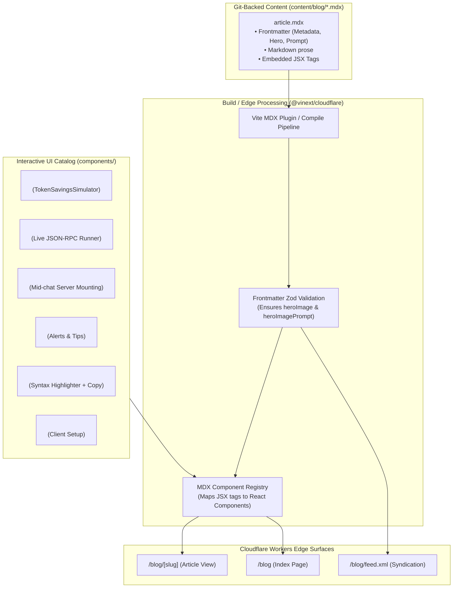

# Product Requirements Document (PRD): Spike Land Interactive MDX Blog (`spike.land/blog`)

**Document Version:** 1.0  
**Target File:** `./prds/blog.md`  
**Target Production URL:** `https://spike.land/blog` & `https://spike.land/blog/[slug]`  
**Date:** 2026-10-23  
**Author:** Spike Land Engineering  
**Status:** Proposed / Ready for Implementation  
**Target Runtime:** Cloudflare Workers (`spike-vinext` Next.js App Router on Vite + Edge V8 Isolates + Cloudflare KV / Static Assets)

---

## 1. Executive Summary & Core Thesis

Spike Land (`spike.land`) is the open-source context and governance control plane for AI coding agents and Model Context Protocol (MCP 2026-07-28) systems. While the landing page (`/` and `/mcp`) effectively communicates core value propositions—Two-Sided Progressive Disclosure, Position-Zero Prompt Cache Preservation, Mid-Chat MCP Server Mounting, and 98.7% Token Cost Reductions—technical decision-makers (staff engineers, AI system architects, CISOs, and venture investors) require **deep, verifiable, technical narrative content**.

The **Spike Land Interactive MDX Blog** (`spike.land/blog`) serves as our primary engineering publication and technical authority engine. Unlike conventional static markdown blogs that force readers to trust abstract claims, every article published on `spike.land/blog`:
1. **Is authored in MDX (Markdown + JSX):** Combining git-backed markdown authoring with full TypeScript/React component capabilities.
2. **Embeds Live, Interactive Platform Components:** Readers can directly manipulate the **Interactive ROI Simulator / Calculator** (`<RoiCalculator />`), execute live JSON-RPC tool calls in the **MCP Playground** (`<McpPlayground />`), walk through mid-chat mounting steps (`<MountMidChat />`), or copy verified `.mcp.json` configuration cards without navigating away from the editorial flow.
3. **Mandates Hero Visuals & Screen-Reader Prompts:** Every published article requires a dedicated hero image accompanied by an embedded generative prompt that doubles as descriptive accessibility alt text.
4. **Executes at Cloudflare Global Edge:** Deployed natively within `spike-vinext` on Cloudflare Workers, achieving sub-50ms Time-to-First-Byte (TTFB) globally with edge caching and zero origin infrastructure.

---

## 2. Problem Statement

1. **Static Articles Cannot Prove Agent Economics:**
   - Technical readers are skeptical of claims like *"saves 98.7% of prompt tokens"* or *"0% Position-Zero prefix cache invalidation."* Static screenshots or text tables fail to convince readers who want to toggle their own team size, daily turns, and model choices (Claude Sonnet 3.5/3.7, GPT-4o, DeepSeek V3) to calculate actual dollar impact.
2. **Context Switching Breaks Developer Evaluation:**
   - When a blog post describes how to mount a remote MCP server or run progressive tool discovery, forcing the reader to leave the article to visit a separate `/playground` or open their IDE causes high drop-off. Embedding live sandboxed playgrounds inside the post keeps readers engaged in the evaluation funnel.
3. **Traditional Headless CMS Overhead vs. Git-Backed Engineering Velocity:**
   - Proprietary CMS platforms (Contentful, Sanity, Ghost) divorce content from the codebase, prevent pull-request reviews on technical posts, break TypeScript type safety for embedded components, and add external runtime dependencies and latencies.
4. **Inconsistent Visual Standards & Accessibility Gaps:**
   - Engineering blog posts frequently lack high-quality visual anchors (hero images) or fail accessibility guidelines (empty or generic `alt="image"` text). A strict schema enforcement mechanism is required to guarantee hero visuals and comprehensive generative prompt descriptions for screen readers on every post.

---

## 3. Goals & Non-Goals

### 3.1 Goals (In-Scope)

* **Canonical `/blog` Index Surface:**
  - Responsive, high-craft editorial index at `spike.land/blog` featuring a hero spotlight article, chronological card grid, category/tag filtering, instant search, estimated reading times, and author profiles.
* **Dynamic `/blog/[slug]` Article Surface:**
  - High-performance MDX rendering pipeline supporting standard Markdown (headings, code blocks, tables, lists, blockquotes) alongside custom interactive React components.
  - Sticky table of contents (TOC) with scroll-spy navigation.
  - Social sharing links (X/Twitter, LinkedIn, Hacker News, Copy Link).
* **First-Class Interactive React Component Embedding:**
  - Seamlessly embed existing and new Spike Land React components into MDX:
    - `<RoiCalculator />` / `<TokenSavingsSimulator />` (token savings & annual financial calculator).
    - `<McpPlayground />` (live edge-relayed MCP 2026-07-28 tool inspection and execution).
    - `<MountMidChat />` (interactive 3-step mid-chat mounting visualization).
    - `<McpConfigSnippet />` (1-click `.mcp.json` installation card for Claude, Cursor, Windsurf).
    - `<Callout />` (informational, warning, tip, and alert containers with Lucide icons).
    - `<CodeBlock />` (syntax-highlighted code blocks with line highlighting, file name badges, and copy buttons).
    - `<Mermaid />` (declarative system architecture flowcharts).
* **Mandatory Hero Image & Prompt Policy:**
  - Enforce in frontmatter schema and build-time validation that every article has a valid `heroImage` path and an explicit `heroImagePrompt` (used for image reproduction and accessible screen-reader alt text).
* **Edge SEO & Syndication Infrastructure:**
  - Automated XML sitemap (`/sitemap.xml`) and RSS 2.0 / Atom feed (`/blog/feed.xml` & `/blog/rss.xml`).
  - Dynamic Open Graph (`og:image`, `og:title`, `og:description`) and Twitter Card (`summary_large_image`) metadata generation using the article's hero image.
  - Schema.org `BlogPosting` and `BreadcrumbList` JSON-LD structured data.
* **Edge Performance on `vinext`:**
  - Zero hydration mismatch, sub-50ms TTFB via Cloudflare Workers edge caching (`Cache-Control: public, s-maxage=86400, stale-while-revalidate=604800`), and clean responsive layouts on mobile, tablet, and ultra-wide displays.

### 3.2 Non-Goals (Out-of-Scope for v1)

* **Multi-Author Web CMS Admin / WYSIWYG Editor:** Content authoring is strictly Git-based via MDX files committed to the repository, reviewed via pull requests, and deployed via CI/CD.
* **Native User Comments Section:** To avoid edge database spam moderation overhead, discussions will link out to GitHub Discussions, Hacker News, or X threads.
* **Paywalled / Gated Content:** All technical articles remain 100% open-access to maximize developer adoption and SEO authority.

---

## 4. Mandatory Hero Image & Generative Prompt Rule

In alignment with Spike Land editorial guidelines:

> **Editorial Mandate:**  
> When editing or creating a blog article, it is **mandatory to include a hero image**. If an image is missing, the author/agent must generate one or provide an image generation prompt. The image generation prompt **must be kept in the article's frontmatter and body** and used as the descriptive `alt` text for screen readers.

### 4.1 Frontmatter Schema Enforcement

```yaml
---
title: "Slashing Agent Token Costs by 98.7%: How Spike Land Preserves LLM Position-Zero Prefix Caches"
slug: "slashing-agent-token-costs-position-zero-cache"
description: "Why naive MCP tool discovery destroys upstream LLM prompt caches, and how Spike Land's Two-Sided Progressive Disclosure maintains 100% cache hits across multi-turn sessions."
date: "2026-10-24"
author:
  name: "Spike Land Team"
  role: "Context Systems Engineering"
  avatar: "/authors/spike-team.png"
  twitter: "@spikeland"
heroImage: "/blog/slashing-agent-token-costs/hero.webp"
heroImagePrompt: "A high-precision architectural visualization of neural network prompt cache layers: glowing cyan data blocks stacked immutably at Position Zero with a laser beam passing through without disturbance, contrasted against a fragmented chaotic amber stream of redundant JSON tool schemas being deflected by a dark hexagonal glass shield. Modern isometric render, dark mode, subtle cobalt and emerald accents, 8k resolution, cinematic lighting."
tags:
  - "Architecture"
  - "MCP"
  - "Prompt Caching"
  - "Cost Optimization"
readingTime: "7 min read"
draft: false
---
```

### 4.2 Accessibility & Provenance Rendering

The article hero banner renders with semantic HTML:

```tsx
<figure className="relative my-8 overflow-hidden rounded-xl border border-border/60 bg-muted/20">
  
  <figcaption className="px-4 py-2 text-xs text-muted-foreground/75 border-t border-border/40 bg-card/60 backdrop-blur-sm flex items-center justify-between">
    <span className="truncate">Hero Visual & Prompt Description</span>
    <button 
      onClick={() => copyPrompt(post.heroImagePrompt)} 
      className="text-primary hover:underline text-[11px] font-mono"
    >
      Copy Prompt
    </button>
  </figcaption>
</figure>
```

---

## 5. MDX Interactive Component Architecture

The blog pipeline bridges static markdown text with living client components located in `components/`.



### 5.1 Embedded Component Specifications

#### 1. `<RoiCalculator />` / `<TokenSavingsSimulator />`
- **Source:** Wraps or imports `components/token-savings-simulator.tsx`.
- **Purpose:** Allows readers to interactively test economic assumptions right inside cost optimization articles.
- **Props:**
  - `defaultDevelopers?: number` (default: 25)
  - `defaultTurns?: number` (default: 150)
  - `highlightModelId?: string` (e.g., `"claude-sonnet-5-5"`, `"gpt-6-astra"`)
  - `compact?: boolean` (if true, renders a simplified card view without the full preset selector)
- **MDX Usage Example:**
  ```mdx
  ### Calculate Your Team's Cache Savings
  
  Adjust your engineering team size and average daily turns below to see projected monthly API bill reductions:
  
  <RoiCalculator defaultDevelopers={50} defaultTurns={200} highlightModelId="claude-sonnet-5-5" />
  ```

#### 2. `<McpPlayground />`
- **Source:** Wraps or imports `components/mcp-playground.tsx`.
- **Purpose:** Allows readers of protocol or tool tutorials to test live tool execution against `/api/mcp` directly from the article.
- **Props:**
  - `initialCategory?: string` (e.g., `"code"`, `"database"`, `"search"`)
  - `initialTool?: string` (e.g., `"execute_tool"`, `"inspect_tool_schema"`)
  - `prefillQuery?: string` (pre-populates search/input fields)
  - `title?: string` (custom callout header above playground)
- **MDX Usage Example:**
  ```mdx
  ### Try Progressive Schema Inspection Live
  
  Observe how `inspect_tool_schema` retrieves tool schemas on-demand without poisoning Token Position Zero:
  
  <McpPlayground initialCategory="web" initialTool="inspect_tool_schema" />
  ```

#### 3. `<MountMidChat />`
- **Source:** Imports `components/mount-mid-chat.tsx`.
- **Purpose:** Demonstrates mid-chat MCP mounting (`mount_mcp_server`) in server-mounting deep dives.
- **Props:**
  - `highlightStep?: 1 | 2 | 3`
- **MDX Usage Example:**
  ```mdx
  <MountMidChat />
  ```

#### 4. `<Callout />`
- **Variants:** `info`, `tip`, `warning`, `danger`
- **Props:**
  - `type?: "info" | "tip" | "warning" | "danger"`
  - `title?: string`
- **MDX Usage Example:**
  ```mdx
  <Callout type="tip" title="Position-Zero Rule">
    Never mutate `tools/list` on active 2026-07-28 sessions. Always return static broker tools at Token Position Zero and disclose target tools in-band.
  </Callout>
  ```

#### 5. `<CodeBlock />` & `<McpConfigSnippet />`
- **Features:** Enhanced syntax highlighting, tabbed multi-language views, line highlight markers (`// [!code highlight]`), and 1-click clipboard integration for `.mcp.json`, `claude_desktop_config.json`, or shell commands (`claude mcp add`).

---

## 6. Information Architecture & URL Hierarchy

```text
spike.land/
├── blog/                                # Blog Home (Index, Category Filter, Search)
│   ├── feed.xml                         # RSS 2.0 Feed for readers & aggregators
│   ├── atom.xml                         # Atom 1.0 Feed
│   ├── tag/[tag]/                       # Tag filtered view (e.g. /blog/tag/mcp)
│   └── [slug]/                          # Individual MDX Article
│       ├── (renders article body)
│       └── opengraph-image.png          # Edge-generated OG preview with hero
```

### 6.1 Route Details

| Route | Type | Edge Strategy | Description |
| :--- | :--- | :--- | :--- |
| `/blog` | Edge SSR / ISR | `s-maxage=3600, swr=86400` | Grid of articles, hero spotlight, filter tags, search input, newsletter CTA. |
| `/blog/[slug]` | Edge SSR / ISR | `s-maxage=86400, swr=604800` | Full MDX post, hero banner with prompt, TOC, embedded components, related posts. |
| `/blog/feed.xml` | API / XML Route | `s-maxage=7200` | Canonical RSS 2.0 feed with full content and enclosure links. |
| `/blog/tag/[tag]` | Edge SSR | `s-maxage=3600, swr=86400` | Tag-filtered post archive. |

---

## 7. Technical Specifications & File Structure

### 7.1 Proposed Directory Organization

```text
spike-vinext/
├── app/
│   └── blog/
│       ├── page.tsx                     # /blog Index listing page
│       ├── layout.tsx                   # Blog layout wrapper (Header, Footer, Sub-nav)
│       ├── [slug]/
│       │   └── page.tsx                 # /blog/[slug] MDX article renderer
│       ├── tag/
│       │   └── [tag]/
│       │       └── page.tsx             # /blog/tag/[tag] filtered listing
│       └── feed.xml/
│           └── route.ts                 # Edge RSS 2.0 / Atom feed handler
├── content/
│   └── blog/                            # Raw MDX source files
│       ├── slashing-agent-token-costs.mdx
│       ├── mid-chat-mcp-server-mounting.mdx
│       └── durable-code-mode-explained.mdx
├── components/
│   └── blog/
│       ├── blog-card.tsx                # Article card for listing grid
│       ├── blog-hero-feature.tsx        # Top featured article banner
│       ├── blog-header.tsx              # Article header with author, date, reading time
│       ├── blog-toc.tsx                 # Scroll-spy Table of Contents
│       ├── blog-share.tsx               # Share buttons (X, LinkedIn, Copy Link)
│       ├── hero-image-display.tsx       # Mandatory hero image + prompt caption viewer
│       ├── mdx-components.tsx           # Component registry mapping (RoiCalculator, etc.)
│       └── callout.tsx                  # Callout boxes (info, tip, warning, danger)
├── lib/
│   └── blog/
│       ├── posts.ts                     # File loader, frontmatter parser & post query methods
│       ├── schema.ts                    # Zod validation schema for blog posts
│       └── rss.ts                       # RSS feed generator
└── public/
    └── blog/                            # Co-located static assets & hero images
        ├── slashing-agent-token-costs/
        │   └── hero.webp
        └── mid-chat-mcp-server-mounting/
            └── hero.webp
```

### 7.2 Data Schema (`lib/blog/schema.ts`)

```typescript
import { z } from "zod";

export const AuthorSchema = z.object({
  name: z.string().min(1),
  role: z.string().default("Contributor"),
  avatar: z.string().default("/authors/spike-team.png"),
  twitter: z.string().optional(),
  github: z.string().optional(),
});

export const BlogPostSchema = z.object({
  title: z.string().min(5).max(120),
  slug: z.string().min(3).regex(/^[a-z0-9-]+$/),
  description: z.string().min(10).max(300),
  date: z.string().regex(/^\d{4}-\d{2}-\d{2}$/),
  updatedDate: z.string().regex(/^\d{4}-\d{2}-\d{2}$/).optional(),
  author: AuthorSchema,
  
  // MANDATORY HERO IMAGE & PROMPT POLICY
  heroImage: z.string().min(1, "A hero image path is mandatory for all blog articles."),
  heroImagePrompt: z.string().min(20, "A detailed hero image generation prompt is mandatory and serves as the screen reader alt description."),
  
  tags: z.array(z.string()).min(1),
  readingTime: z.string().optional(),
  featured: z.boolean().default(false),
  draft: z.boolean().default(false),
  canonicalUrl: z.string().url().optional(),
});

export type BlogPost = z.infer<typeof BlogPostSchema> & {
  content: string; // Raw MDX content
};
```

---

## 8. User Experience & Design Language

The blog interface adheres strictly to the **Spike Land Design System** (`DESIGN.md`):
- **Typography:** Display serif/sans hybrid (`font-display font-black`) for article headings; monospace (`font-mono`) for metadata, metrics, and tags; neutral sans for body copy.
- **Palette:** Dark-mode primary aesthetic with rich obsidian background (`#0A0C0E`), crisp high-contrast border treatment (`border-[#111315]` or `border-border/60`), subtle slate cards, and cobalt/emerald accent glows.
- **Header & Navigation Integration:**
  - Add a dedicated **"Blog"** link to `components/header.tsx` (between "Docs" and "Playground" or after "ROI Simulator").
  - Update `components/footer.tsx` under the "Developers" and "Company" columns to link to `/blog` and `/blog/feed.xml`.
- **Tactile Details:**
  - Reading progress bar pinned to the top of the viewport on article pages.
  - Interactive component wrappers featured in clean bordered "sandbox frames" with a label badge: `"Interactive Component • Live Edge Sandbox"`.

---

## 9. Launch Articles (Initial Content Portfolio)

To validate the MDX engine and demonstrate custom component integration upon launch, three flagship articles will be prepared:

### 9.1 Article 1: *"Slashing Agent Token Costs by 98.7%: How Spike Land Preserves LLM Position-Zero Prefix Caches"*
- **Target Slug:** `slashing-agent-token-costs-position-zero-cache`
- **Embedded Component:** `<RoiCalculator defaultDevelopers={25} defaultTurns={150} />`
- **Content Focus:** Explains why naive `tools/list` mutation on standard MCP proxies busts prefix caches on every turn, and how Spike Land's 5 static broker meta-tools combined with tail disclosure preserve 100% of LLM prefix cache hits.

### 9.2 Article 2: *"Zero-Restart Tool Mounting: Adding MCP Servers Mid-Chat at the Cloudflare Edge"*
- **Target Slug:** `mid-chat-mcp-server-mounting`
- **Embedded Components:** `<MountMidChat />` and `<McpPlayground initialCategory="database" initialTool="execute_tool" />`
- **Content Focus:** Explores the architectural mechanics of `mount_mcp_server`, schema interception at Cloudflare Workers, and on-demand discovery with zero IDE restarts.

### 9.3 Article 3: *"From Atomic Tools to Stateful Code: Inside the Durable Code Mode Runtime"*
- **Target Slug:** `durable-code-mode-runtime`
- **Embedded Component:** `<McpPlayground />` with TypeScript code execution sample.
- **Content Focus:** Introduces `@cloudflare/codemode` integration, moving from repetitive JSON-RPC ping-pong to isolated async JavaScript workflows with approval checkpoints and replay.

---

## 10. SEO, Performance & Core Web Vitals Targets

1. **Core Web Vitals:**
   - **Largest Contentful Paint (LCP):** < 1.2s globally (Hero image preloaded with `fetchPriority="high"` and served in WebP/AVIF format).
   - **Interaction to Next Paint (INP):** < 50ms (React 19 concurrent hydration; heavy components like the Playground lazy-hydrated or client-only).
   - **Cumulative Layout Shift (CLS):** 0.00 (Fixed aspect ratios on hero images and component frames).
2. **Metadata & Open Graph:**
   - Automated generation of Open Graph tags for Twitter/X and LinkedIn previews:
     ```html
     <meta property="og:title" content="Slashing Agent Token Costs by 98.7% | Spike Land Blog" />
     <meta property="og:description" content="Why naive MCP tool discovery destroys upstream LLM prompt caches..." />
     <meta property="og:image" content="https://spike.land/blog/slashing-agent-token-costs/hero.webp" />
     <meta name="twitter:card" content="summary_large_image" />
     <meta name="twitter:image:alt" content="[heroImagePrompt content]" />
     ```
3. **Structured Data:**
   - Injected `<script type="application/ld+json">` containing `BlogPosting`, `publisher: Organization (Spike Land)`, `author: Person`, and `image`.

---

## 11. Implementation Plan & Milestones

| Phase | Milestone | Key Deliverables |
| :--- | :--- | :--- |
| **Phase 1: Content Infrastructure** | MDX Parser & Schema | • Set up `content/blog/` directory.<br>• Implement `lib/blog/posts.ts` with frontmatter extraction and Zod validation.<br>• Enforce mandatory `heroImage` and `heroImagePrompt`.<br>• Configure MDX component registry in `components/blog/mdx-components.tsx`. |
| **Phase 2: Core Blog Surfaces** | Index & Post Layouts | • Implement `/blog` listing page (`app/blog/page.tsx`) with search and tag filters.<br>• Implement `/blog/[slug]` article view with TOC, reading time, and share buttons.<br>• Implement Hero visual display with prompt copy caption (`components/blog/hero-image-display.tsx`). |
| **Phase 3: Interactive Component Bridges** | MDX Component Embeds | • Wrap `TokenSavingsSimulator` as `<RoiCalculator />` for MDX.<br>• Wrap `McpPlayground` with configurable initial props.<br>• Test embedded component hydration and responsiveness across mobile and desktop. |
| **Phase 4: Syndication & SEO** | RSS & Open Graph | • Build RSS 2.0 / Atom XML feed at `app/blog/feed.xml/route.ts`.<br>• Generate JSON-LD structured data and dynamic Open Graph tags.<br>• Update `components/header.tsx` and `components/footer.tsx` with blog links. |
| **Phase 5: Flagship Content & QA** | Initial Articles & Tests | • Author the 3 launch articles with hero images and prompts.<br>• Write Vitest unit tests verifying frontmatter validation, MDX rendering, and RSS feed XML generation.<br>• Deploy and verify sub-50ms TTFB on Cloudflare Workers preview. |

---

## 12. Success Metrics

1. **Reader Engagement:** Average time-on-page > 3.5 minutes on technical deep dives.
2. **Interactive Component Usage:** > 25% of readers interact with the embedded `<RoiCalculator />` or `<McpPlayground />` on relevant articles.
3. **Conversion Funnel:** > 8% click-through from blog CTAs to `/waitlist`, `/chat`, or GitHub repo.
4. **Editorial Integrity:** 100% of published articles pass build-time schema validation with valid hero images and accessibility prompts.
