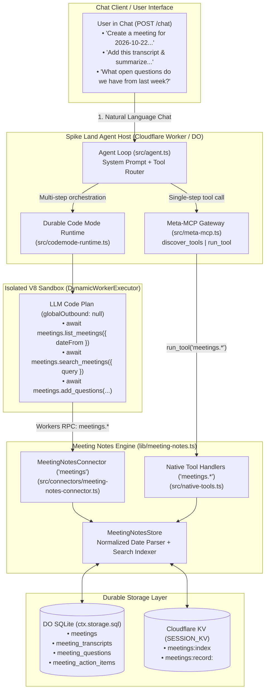

# Product Requirements Document (PRD): Conversational Meeting Notes & Knowledge Base (`meetings.*`)

**Document Version:** 1.0  
**Target File:** `./prds/meetingNotes.md`  
**Date:** 2026-10-22  
**Author:** Spike Land Engineering  
**Status:** Proposed / Ready for Implementation  
**Target Runtime:** Cloudflare Workers (`spike-vinext` / Agent Chat Harness + Meta-MCP Gateway + Durable Code Mode Runtime + Durable Object SQLite / `SESSION_KV`)

---

## 1. Executive Summary & Core Thesis

Users interacting with the Spike Land Agent via chat (`POST /chat` or `/api/chat`) need a first-class, conversational way to **capture, enrich, organize, and query meeting notes over time** without leaving the chat interface.

Through natural language prompts in the chat, users must be able to:
1. **Create Meetings with Dates & Context:** Schedule or log meetings with explicit dates (`YYYY-MM-DD` or ISO-8601 timestamps), titles, attendees/participants, tags, and external links.
2. **Attach & Append Transcripts:** Paste raw transcripts, append incremental transcript chunks/speaker turns (`speaker`, `timestamp`, `text`), or import transcripts extracted via `browser.*` tools.
3. **Add & Synthesize Summaries:** Store structured meeting summaries (executive TL;DR, key decisions, discussion topics, and takeaways)—either user-provided or automatically synthesized by the LLM from the meeting's transcript.
4. **Track Questions & Action Items:** Record open/resolved questions (`question`, `askedBy`, `answer`, `status`) and actionable follow-ups (`task`, `owner`, `dueDate`, `status`) tied to a specific meeting.
5. **Access, Search & Cross-Reference Older Meeting Notes:** Retrieve past meetings by date range, participant, tag, or keyword; inspect historical transcripts, summaries, and unresolved questions; and run multi-meeting synthesis queries inside Durable Code Mode (`codemode`).

By implementing **Meeting Notes** as both a native Meta-MCP namespace (`meetings.*` via `discover_tools` and `run_tool`) and a first-class **Durable Code Mode Connector** (`MeetingNotesConnector` bound as the global `meetings` namespace in `DynamicWorkerExecutor`), the agent can handle both quick 1-turn chat commands (*"Create a meeting for today's Q4 Product Sync and add this transcript..."*) and complex multi-meeting analytical workflows (*"Find all unanswered questions from our October architecture meetings and cross-check them against our latest sprint notes"*).

---

## 2. Problem Statement

1. **Ephemeral Chat Context Loses Historical Meeting Knowledge:**
   - When a user pastes a meeting transcript or asks the chat agent to summarize a call today, that knowledge is trapped in the transient `messages[]` array of a single chat request. Once the session resets or moves on, older meeting transcripts, decisions, and open questions are inaccessible.
2. **Unstructured Notes Prevent Temporal & Entity Queries:**
   - Users naturally refer to meetings by date (*"What did we decide in last Tuesday's meeting?"*, *"Show me notes from October 15"*), by topic/tag (*"roadmap"*), or by artifact type (*"What open questions are still unresolved from the last 3 meetings?"*). Without structured schemas for `meetings`, `transcripts`, `summaries`, `questions`, and `action_items`, the agent cannot reliably filter or aggregate historical records.
3. **Large Transcripts Overflow LLM Context Windows During Multi-Meeting Lookups:**
   - A 60-minute meeting transcript can easily reach 30–60 KB of text. If a user asks a question spanning 5 past meetings, loading all 5 full transcripts via sequential `run_tool` calls bloats `messages[]` and hits `MAX_LOOP_STEPS`.
   - Exposing `meetings.*` inside `codemode` allows the agent to write a compact JavaScript query that searches transcripts, filters specific sections or open questions in the isolated V8 sandbox, and returns only the distilled result to the LLM context.
4. **Accidental Deletion Without Governance:**
   - Deleting a historical meeting record or overwriting a curated summary is a destructive operation that should support Durable Code Mode's Human-in-the-Loop (`requiresApproval: true`) and rollback (`revertHandler`) guarantees.

---

## 3. User Stories & Conversational Workflows

| ID | Persona / Trigger | Conversational User Prompt (via `/chat`) | Expected Agent Behavior |
| :--- | :--- | :--- | :--- |
| **US-1** | **Create Meeting with Date** | *"Create a meeting called 'Q4 Edge Runtime Sync' for 2026-10-22 at 14:00 UTC with Alice, Bob, and Zoltan, tagged #architecture and #workers."* | Calls `meetings.create_meeting` with normalized date `2026-10-22`, start time, attendees, and tags; returns the created `meetingId` and confirmation summary. |
| **US-2** | **Add / Append Transcript** | *"Here is the transcript for the Q4 Edge Runtime Sync: [Alice 00:01]: Let's review SQLite replay... [Bob 00:45]: How do we handle 32KB limits?"* | Resolves the meeting (by ID or title/date) and calls `meetings.add_transcript` to store both the full raw text and parsed speaker segments. |
| **US-3** | **Add / Generate Summary & Decisions** | *"Summarize that transcript and save the executive summary and key decisions to the meeting notes."* | Reads the transcript (if not already in context), synthesizes a structured summary + key decisions + takeaways, and calls `meetings.save_summary`. |
| **US-4** | **Log & Resolve Questions / Action Items** | *"Add two questions to today's meeting: 1) 'Does KV fallback support FTS?' (open, asked by Bob) and 2) 'Should we cap transcripts at 64KB?' (answered: 'Yes, chunked in SQLite')."* | Calls `meetings.add_questions` (and optionally `meetings.add_action_items`) to persist structured Q&A entries on the meeting record. |
| **US-5** | **Browse Older Meetings by Date / Filter** | *"What meetings did we have in October 2026? Show me the ones with Bob."* | Calls `meetings.list_meetings({ dateFrom: "2026-10-01", dateTo: "2026-10-31", participant: "Bob" })` and presents a chronological digest. |
| **US-6** | **Retrieve Full Historical Meeting Notes** | *"Open the meeting notes from the October 15 Design Review including its summary and open questions."* | Calls `meetings.get_meeting({ meetingId, includeTranscript: false })` (or `includeTranscript: true` when requested) and formats the historical notes clearly. |
| **US-7** | **Cross-Meeting Search & Question Rollup (`codemode`)** | *"Search all older meeting notes for 'SerpApi' or 'SQLite' and list every unanswered question across all past meetings."* | Uses `meetings.search_meetings` or a 1-turn `codemode` script iterating over `await meetings.list_meetings(...)` and `await meetings.list_questions({ status: "open" })` to return a unified report. |

---

## 4. Goals & Non-Goals

### 4.1 Goals (In-Scope)
* **Complete Conversational CRUD for Meetings:** Create, read, update, list, search, and delete meetings with first-class date (`meetingDate`), time, attendee, and tag indexing.
* **Rich Sub-Document Management:** Dedicated tools and storage tables for:
  * **Transcripts (`meetings.add_transcript`, `meetings.get_transcript`):** Support full text, append mode for multi-part transcripts, and structured speaker segments (`speaker`, `timestamp`, `text`).
  * **Summaries (`meetings.save_summary`):** Store executive summary markdown, bulleted key decisions, takeaways, and topics.
  * **Questions (`meetings.add_questions`, `meetings.update_question`, `meetings.list_questions`):** Track questions raised during or after a meeting (`open` | `answered` | `deferred`), who asked them, and their answers.
  * **Action Items (`meetings.add_action_items`, `meetings.update_action_item`):** Track follow-up tasks, owners, due dates, and completion status (`pending` | `in_progress` | `done`).
* **Dual Execution Surface (`run_tool` + `codemode`):**
  * Register `meetings.*` in `src/native-tools.ts` so `discover_tools` and `run_tool` work out of the box.
  * Register `MeetingNotesConnector` (`namespace: "meetings"`) in `src/codemode-runtime.ts` so LLM code plans in `DynamicWorkerExecutor` can call `await meetings.create_meeting(...)`, `await meetings.search_meetings(...)`, etc.
* **Durable Persistence (SQLite + `SESSION_KV`):**
  * Primary relational + full-text storage in Durable Object SQLite (`ctx.storage.sql`) with automatic mirroring/fallback to `SESSION_KV` (`MEETINGS_KV` / `SESSION_KV` key prefix `meetings:index` and `meetings:item:<id>`) so older meeting notes persist across stateless `/chat` calls and local dev sessions.
* **Governance & Rollback Support:**
  * Mark `meetings.delete_meeting` with `requiresApproval: true` in `MeetingNotesConnector` so accidental mass deletion pauses for human approval.
  * Provide a `revert` handler so `runtime.rollback({ executionId })` can restore modified or created meeting records if a multi-step `codemode` workflow is rolled back.

### 4.2 Non-Goals
* **Real-Time WebRTC Audio/Video Capture:** This PRD focuses on text/chat-driven meeting creation, transcript ingestion, summarization, Q&A tracking, and historical retrieval—not live microphone/WebRTC media streaming or Whisper ASR model hosting.
* **External Calendar Two-Way Sync (Google Calendar / Outlook OAuth):** While meetings store dates, start/end times, and optional `externalCalendarUrl` metadata (and can be combined with mounted calendar MCP servers in `codemode`), native OAuth calendar syncing is out of scope for the core `meetings.*` module.

---

## 5. System Architecture & Runtime Flow

### 5.1 High-Level Architecture



### 5.2 Conversational Lifecycle: Create $\rightarrow$ Transcribe $\rightarrow$ Summarize $\rightarrow$ Query Older Notes

```text
┌─────────┐          ┌──────────────────────────┐          ┌─────────────────────────┐          ┌────────────────────────┐
│  User   │          │  Agent Loop (/chat)      │          │  MeetingNotesConnector  │          │  DO SQLite + KV Store  │
└────┬────┘          └────────────┬─────────────┘          └────────────┬────────────┘          └───────────┬────────────┘
     │                            │                                     │                                   │
     │ 1. "Create a meeting for   │                                     │                                   │
     │    2026-10-22: Sprint      │                                     │                                   │
     │    Retro with team, and    │                                     │                                   │
     │    save this transcript,   │                                     │                                   │
     │    summary, and questions" │                                     │                                   │
     ├───────────────────────────►│ 2. Execute `codemode` (or tools):   │                                   │
     │                            │    a) meetings.create_meeting(...)  │                                   │
     │                            │    b) meetings.add_transcript(...)  │                                   │
     │                            │    c) meetings.save_summary(...)    │                                   │
     │                            │    d) meetings.add_questions(...)   │                                   │
     │                            ├────────────────────────────────────►│ 3. Persist normalized meeting     │
     │                            │                                     │    record, transcript segments,   │
     │                            │                                     │    summary, and Q&A items         │
     │                            │                                     ├──────────────────────────────────►│
     │                            │◄────────────────────────────────────┼───────────────────────────────────┤
     │ 4. Returns structured      │                                     │                                   │
     │    confirmation + ID       │                                     │                                   │
     │◄───────────────────────────┤                                     │                                   │
     │                            │                                     │                                   │
     │ 5. (Days Later)            │                                     │                                   │
     │    "Show me our older      │                                     │                                   │
     │    meetings from October   │                                     │                                   │
     │    and any open questions" │                                     │                                   │
     ├───────────────────────────►│ 6. Call `meetings.list_meetings`    │                                   │
     │                            │    & `meetings.list_questions`      │                                   │
     │                            ├────────────────────────────────────►│ 7. Query by date range & status   │
     │                            │                                     ├──────────────────────────────────►│
     │ 8. Presents chronological  │◄────────────────────────────────────┼───────────────────────────────────┤
     │    notes & open questions  │                                     │                                   │
     │◄───────────────────────────┤                                     │                                   │
```

---

## 6. Data Models & Storage Schema

### 6.1 TypeScript Domain Models (`src/types.ts` / `lib/meeting-notes.ts`)

```typescript
export type MeetingStatus = "scheduled" | "in_progress" | "completed" | "archived";
export type QuestionStatus = "open" | "answered" | "deferred";
export type ActionItemStatus = "pending" | "in_progress" | "done" | "cancelled";

export interface TranscriptSegment {
  id: string;
  speaker?: string;
  timestamp?: string; // e.g., "00:04:12" or ISO timestamp
  text: string;
  createdAt: number;
}

export interface MeetingSummary {
  executiveSummary: string;      // Concise TL;DR paragraph or markdown
  keyDecisions: string[];        // Explicit decisions made in the meeting
  takeaways: string[];           // Key insights or highlights
  topics: string[];              // Discussed agenda topics / sections
  updatedAt: number;
}

export interface MeetingQuestion {
  id: string;
  meetingId: string;
  question: string;
  askedBy?: string;
  answeredBy?: string;
  answer?: string;
  status: QuestionStatus;
  tags?: string[];
  createdAt: number;
  updatedAt: number;
}

export interface MeetingActionItem {
  id: string;
  meetingId: string;
  task: string;
  owner?: string;
  dueDate?: string;              // ISO date YYYY-MM-DD
  status: ActionItemStatus;
  createdAt: number;
  updatedAt: number;
}

export interface MeetingNoteRecord {
  id: string;                    // e.g., "mtg_20261022_a8f9c2"
  title: string;
  meetingDate: string;           // Canonical ISO date "YYYY-MM-DD" for chronological sorting/filtering
  startTime?: string;            // Optional ISO-8601 datetime or "HH:mm"
  endTime?: string;
  status: MeetingStatus;
  participants: string[];        // e.g., ["Alice", "Bob", "Zoltan"]
  tags: string[];                // e.g., ["architecture", "q4-planning"]
  locationOrUrl?: string;        // e.g., Zoom/Meet link or room name
  summary?: MeetingSummary;
  transcriptText: string;        // Combined raw transcript text
  transcriptSegments: TranscriptSegment[];
  questions: MeetingQuestion[];
  actionItems: MeetingActionItem[];
  notesMarkdown?: string;        // General free-form scratchpad / additional markdown notes
  createdAt: number;
  updatedAt: number;
}
```

### 6.2 Durable Object SQLite Schema (`ctx.storage.sql`)

When running with Durable Object SQLite (or `DatabaseSync` in local/Node test environments), `MeetingNotesStore` initializes the following normalized tables for fast date-range filtering and full-text search:

```sql
CREATE TABLE IF NOT EXISTS meetings (
  id TEXT PRIMARY KEY,
  title TEXT NOT NULL,
  meeting_date TEXT NOT NULL,         -- YYYY-MM-DD
  start_time TEXT,
  end_time TEXT,
  status TEXT NOT NULL DEFAULT 'completed',
  participants_json TEXT NOT NULL DEFAULT '[]',
  tags_json TEXT NOT NULL DEFAULT '[]',
  location_or_url TEXT,
  summary_json TEXT,                  -- JSON-serialized MeetingSummary
  transcript_text TEXT NOT NULL DEFAULT '',
  transcript_segments_json TEXT NOT NULL DEFAULT '[]',
  notes_markdown TEXT,
  created_at INTEGER NOT NULL,
  updated_at INTEGER NOT NULL
);

CREATE INDEX IF NOT EXISTS idx_meetings_date
  ON meetings (meeting_date DESC, updated_at DESC);

CREATE TABLE IF NOT EXISTS meeting_questions (
  id TEXT PRIMARY KEY,
  meeting_id TEXT NOT NULL,
  question TEXT NOT NULL,
  asked_by TEXT,
  answered_by TEXT,
  answer TEXT,
  status TEXT NOT NULL DEFAULT 'open',
  tags_json TEXT NOT NULL DEFAULT '[]',
  created_at INTEGER NOT NULL,
  updated_at INTEGER NOT NULL,
  FOREIGN KEY (meeting_id) REFERENCES meetings(id) ON DELETE CASCADE
);

CREATE INDEX IF NOT EXISTS idx_meeting_questions_meeting
  ON meeting_questions (meeting_id, status);

CREATE TABLE IF NOT EXISTS meeting_action_items (
  id TEXT PRIMARY KEY,
  meeting_id TEXT NOT NULL,
  task TEXT NOT NULL,
  owner TEXT,
  due_date TEXT,
  status TEXT NOT NULL DEFAULT 'pending',
  created_at INTEGER NOT NULL,
  updated_at INTEGER NOT NULL,
  FOREIGN KEY (meeting_id) REFERENCES meetings(id) ON DELETE CASCADE
);

CREATE INDEX IF NOT EXISTS idx_meeting_action_items_meeting
  ON meeting_action_items (meeting_id, status);
```

### 6.3 Cross-Session KV Synchronization (`SESSION_KV`)

To ensure users can access their older meeting notes from **any** chat session or stateless Worker invocation even when a new `sessionId` is started:
- Every write operation (`create_meeting`, `update_meeting`, `add_transcript`, `save_summary`, `add_questions`, `update_question`, `add_action_items`, `delete_meeting`) persists the `MeetingNoteRecord` to `SESSION_KV` under:
  - `meetings:record:<meetingId>` $\rightarrow$ full `MeetingNoteRecord` JSON.
  - `meetings:index` $\rightarrow$ lightweight chronological index array of `{ id, title, meetingDate, startTime, status, participants, tags, hasTranscript, hasSummary, questionCount, openQuestionCount, actionItemCount, updatedAt }`.
- This hybrid SQLite + KV design guarantees sub-millisecond in-memory/SQLite queries during `codemode` loops while preserving long-term meeting history across Worker restarts and sessions.

---

## 7. Detailed Tool Specifications (`meetings.*` Namespace)

All tools below are exposed both:
1. To the Meta-MCP Gateway (`discover_tools` and `run_tool` as `meetings.<tool_name>`).
2. Inside the Durable Code Mode sandbox (`DynamicWorkerExecutor` as `await meetings.<tool_name>(args)`).

### 7.1 `meetings.create_meeting`
Creates a new meeting record with a date, title, optional participants/tags, and optional initial transcript, summary, questions, or action items.

* **Approval Policy:** `requiresApproval: false`, `replay: "log"`
* **Input Schema:**
```json
{
  "type": "object",
  "properties": {
    "title": {
      "type": "string",
      "description": "Title or subject of the meeting (e.g., 'Q4 Product Architecture Sync')."
    },
    "meetingDate": {
      "type": "string",
      "description": "Date of the meeting in 'YYYY-MM-DD' format or ISO-8601 timestamp (e.g., '2026-10-22'). Defaults to today's date if omitted."
    },
    "startTime": {
      "type": "string",
      "description": "Optional start time (e.g., '14:00 UTC' or '2026-10-22T14:00:00Z')."
    },
    "endTime": {
      "type": "string",
      "description": "Optional end time."
    },
    "status": {
      "type": "string",
      "enum": ["scheduled", "in_progress", "completed", "archived"],
      "default": "completed",
      "description": "Lifecycle status of the meeting."
    },
    "participants": {
      "type": "array",
      "items": { "type": "string" },
      "description": "List of attendee names or emails."
    },
    "tags": {
      "type": "array",
      "items": { "type": "string" },
      "description": "Topic or project tags (e.g., ['roadmap', 'engineering'])."
    },
    "locationOrUrl": {
      "type": "string",
      "description": "Optional meeting link (Zoom/Meet) or physical room."
    },
    "transcript": {
      "type": "string",
      "description": "Optional initial raw transcript text to attach upon creation."
    },
    "summary": {
      "type": "object",
      "properties": {
        "executiveSummary": { "type": "string" },
        "keyDecisions": { "type": "array", "items": { "type": "string" } },
        "takeaways": { "type": "array", "items": { "type": "string" } },
        "topics": { "type": "array", "items": { "type": "string" } }
      },
      "description": "Optional initial structured summary."
    },
    "questions": {
      "type": "array",
      "items": {
        "type": "object",
        "properties": {
          "question": { "type": "string" },
          "askedBy": { "type": "string" },
          "answer": { "type": "string" },
          "status": { "type": "string", "enum": ["open", "answered", "deferred"] }
        },
        "required": ["question"]
      },
      "description": "Optional initial questions raised in the meeting."
    },
    "actionItems": {
      "type": "array",
      "items": {
        "type": "object",
        "properties": {
          "task": { "type": "string" },
          "owner": { "type": "string" },
          "dueDate": { "type": "string" },
          "status": { "type": "string", "enum": ["pending", "in_progress", "done", "cancelled"] }
        },
        "required": ["task"]
      },
      "description": "Optional initial action items."
    },
    "notesMarkdown": {
      "type": "string",
      "description": "Optional free-form markdown notes."
    }
  },
  "required": ["title"]
}
```

---

### 7.2 `meetings.add_transcript`
Adds, replaces, or appends transcript content (raw text and/or speaker-attributed segments) to an existing meeting. Automatically parses `[Speaker HH:MM]: text` or `Speaker: text` lines into structured `transcriptSegments` when `segments` are not explicitly passed.

* **Approval Policy:** `requiresApproval: false`, `replay: "log"`
* **Input Schema:**
```json
{
  "type": "object",
  "properties": {
    "meetingId": {
      "type": "string",
      "description": "Target meeting ID (e.g., 'mtg_20261022_a8f9c2')."
    },
    "transcript": {
      "type": "string",
      "description": "Raw transcript text to store or append."
    },
    "segments": {
      "type": "array",
      "items": {
        "type": "object",
        "properties": {
          "speaker": { "type": "string", "description": "Speaker name or identifier." },
          "timestamp": { "type": "string", "description": "Timestamp offset (e.g., '00:03:15')." },
          "text": { "type": "string", "description": "Spoken utterance text." }
        },
        "required": ["text"]
      },
      "description": "Optional structured speaker turns."
    },
    "mode": {
      "type": "string",
      "enum": ["append", "replace"],
      "default": "append",
      "description": "'append' adds to the existing transcript; 'replace' overwrites it."
    }
  },
  "required": ["meetingId"]
}
```

---

### 7.3 `meetings.save_summary`
Creates or updates the structured summary (`executiveSummary`, `keyDecisions`, `takeaways`, `topics`, and optional `notesMarkdown`) for a meeting.

* **Approval Policy:** `requiresApproval: false`, `replay: "log"`
* **Input Schema:**
```json
{
  "type": "object",
  "properties": {
    "meetingId": {
      "type": "string",
      "description": "Target meeting ID."
    },
    "executiveSummary": {
      "type": "string",
      "description": "High-level executive summary of the meeting."
    },
    "keyDecisions": {
      "type": "array",
      "items": { "type": "string" },
      "description": "List of concrete decisions agreed upon during the meeting."
    },
    "takeaways": {
      "type": "array",
      "items": { "type": "string" },
      "description": "Key insights, highlights, or risks discussed."
    },
    "topics": {
      "type": "array",
      "items": { "type": "string" },
      "description": "Main agenda items or topics covered."
    },
    "notesMarkdown": {
      "type": "string",
      "description": "Optional additional markdown notes to attach or update."
    },
    "mergeArrays": {
      "type": "boolean",
      "default": false,
      "description": "If true, appends new decisions/takeaways/topics to existing ones instead of replacing them."
    }
  },
  "required": ["meetingId", "executiveSummary"]
}
```

---

### 7.4 `meetings.add_questions` & `meetings.update_question`
Allows the user or agent to log questions raised in a meeting (along with who asked them and any answers) and later resolve or update them as answers are found.

* **`meetings.add_questions` Input Schema:**
```json
{
  "type": "object",
  "properties": {
    "meetingId": {
      "type": "string",
      "description": "Target meeting ID."
    },
    "questions": {
      "type": "array",
      "items": {
        "type": "object",
        "properties": {
          "question": { "type": "string", "description": "The question text." },
          "askedBy": { "type": "string", "description": "Person who raised the question." },
          "answeredBy": { "type": "string", "description": "Person who answered the question (if answered)." },
          "answer": { "type": "string", "description": "Answer or resolution details (if answered)." },
          "status": {
            "type": "string",
            "enum": ["open", "answered", "deferred"],
            "default": "open"
          },
          "tags": {
            "type": "array",
            "items": { "type": "string" }
          }
        },
        "required": ["question"]
      },
      "description": "List of questions to attach to the meeting."
    }
  },
  "required": ["meetingId", "questions"]
}
```

* **`meetings.update_question` Input Schema:**
```json
{
  "type": "object",
  "properties": {
    "meetingId": {
      "type": "string",
      "description": "Target meeting ID."
    },
    "questionId": {
      "type": "string",
      "description": "ID of the question to update (e.g., 'q_1')."
    },
    "answer": {
      "type": "string",
      "description": "The answer or resolution to record."
    },
    "answeredBy": {
      "type": "string",
      "description": "Who provided the answer."
    },
    "status": {
      "type": "string",
      "enum": ["open", "answered", "deferred"],
      "description": "Updated status (automatically defaults to 'answered' if 'answer' is provided)."
    }
  },
  "required": ["meetingId", "questionId"]
}
```

---

### 7.5 `meetings.add_action_items` & `meetings.update_action_item`
Logs and updates concrete action items / follow-up tasks from a meeting.

* **`meetings.add_action_items` Input Schema:**
```json
{
  "type": "object",
  "properties": {
    "meetingId": { "type": "string" },
    "actionItems": {
      "type": "array",
      "items": {
        "type": "object",
        "properties": {
          "task": { "type": "string" },
          "owner": { "type": "string" },
          "dueDate": { "type": "string", "description": "Due date (YYYY-MM-DD)." },
          "status": { "type": "string", "enum": ["pending", "in_progress", "done", "cancelled"], "default": "pending" }
        },
        "required": ["task"]
      }
    }
  },
  "required": ["meetingId", "actionItems"]
}
```

* **`meetings.update_action_item` Input Schema:**
```json
{
  "type": "object",
  "properties": {
    "meetingId": { "type": "string" },
    "actionItemId": { "type": "string" },
    "status": { "type": "string", "enum": ["pending", "in_progress", "done", "cancelled"] },
    "owner": { "type": "string" },
    "dueDate": { "type": "string" },
    "task": { "type": "string" }
  },
  "required": ["meetingId", "actionItemId"]
}
```

---

### 7.6 Accessing Older Meeting Notes: `meetings.list_meetings`, `meetings.get_meeting`, `meetings.search_meetings`, & `meetings.list_questions`

To make accessing older meeting notes fast, flexible, and context-efficient:

1. **`meetings.list_meetings` (Chronological & Filtered Directory):**
   - Lists meetings ordered by `meetingDate DESC, updatedAt DESC`.
   - Supports filtering by:
     - `dateFrom` (`YYYY-MM-DD`) and `dateTo` (`YYYY-MM-DD`) for date-range queries (e.g., *"last week"*, *"October 2026"*).
     - `onDate` (`YYYY-MM-DD`) for exact date lookups.
     - `participant` (case-insensitive substring/name match).
     - `tag` (topic tag filter).
     - `status` (`scheduled` | `in_progress` | `completed` | `archived`).
     - `limit` (default `20`, max `100`) and `offset` (default `0`).
   - Returns compact metadata + `executiveSummary` preview + counts (`questionCount`, `openQuestionCount`, `actionItemCount`, `transcriptLength`) so the LLM can browse dozens of older meetings without exhausting context tokens.

2. **`meetings.get_meeting` (Deep Inspection of a Specific Meeting):**
   - Retrieves the complete record for a meeting by `meetingId` (or by `title` + optional `meetingDate` if the user refers to a meeting conversationally by name/date).
   - Supports `includeTranscript?: boolean` (default `true`) and `transcriptMaxChars?: number` (default `16000`) to prevent accidental context overflow on huge transcripts.

3. **`meetings.search_meetings` (Full-Text & Semantic Keyword Search Across All Older Notes):**
   - Searches across `title`, `summary` (`executiveSummary`, `keyDecisions`, `takeaways`), `transcriptText`, `questions`, `actionItems`, and `notesMarkdown`.
   - Supports optional `dateFrom`, `dateTo`, `participant`, and `tag` scoping.
   - Returns ranked matches with **contextual snippets** (`matchedFields`, `transcriptSnippet`, `matchedQuestions`, `executiveSummary`) so the agent immediately sees *where* and *why* an older meeting matched.

4. **`meetings.list_questions` (Cross-Meeting Question & Knowledge Gap Tracker):**
   - Queries questions across **all** meetings (or scoped by `meetingId`, `status: "open" | "answered" | "deferred"`, `askedBy`, `dateFrom`, `dateTo`).
   - Enables instant answers to prompts like *"What open questions do we still have from our past meetings?"*

5. **`meetings.delete_meeting` (Governed Deletion):**
   - Deletes a meeting record by `meetingId`.
   - Configured with `requiresApproval: true` inside `MeetingNotesConnector` so any automated script attempting to delete historical meeting notes pauses for explicit user approval via `/chat/approve`.

---

## 8. Durable Code Mode (`codemode`) Orchestration Examples

Because `MeetingNotesConnector` is bound as the global `meetings` namespace inside `DynamicWorkerExecutor`, the agent can execute rich multi-step workflows in a **single LLM turn**.

### 8.1 Example 1: One-Turn Meeting Creation with Transcript, Summary, Questions & Action Items
```javascript
async () => {
  const created = await meetings.create_meeting({
    title: "Spike Land Meta-MCP & SerpApi Sync",
    meetingDate: "2026-10-22",
    startTime: "15:00 UTC",
    participants: ["Zoltan", "Alice", "Bob"],
    tags: ["mcp", "serpapi", "architecture"],
    transcript: [
      "[Zoltan 00:00]: Let's review the SerpApi MCP integration and meeting notes PRD.",
      "[Alice 01:15]: URL placeholder interpolation is working and keeps SERPAPI_API_KEY out of SESSION_KV.",
      "[Bob 02:30]: Question: how should older meeting transcripts be indexed for cross-meeting search?",
      "[Zoltan 03:10]: Let's store them in DO SQLite with SESSION_KV sync so they survive across sessions."
    ].join("\n"),
    summary: {
      executiveSummary: "Reviewed SerpApi MCP zero-leakage auth and designed the dual SQLite + KV storage architecture for conversational meeting notes.",
      keyDecisions: [
        "Use host-side URL template interpolation for SERPAPI_API_KEY.",
        "Persist meeting notes in DO SQLite with SESSION_KV synchronization."
      ],
      takeaways: [
        "Code Mode allows multi-meeting transcript filtering without bloating LLM context."
      ],
      topics: ["SerpApi MCP", "Meeting Notes Storage", "Code Mode Connectors"]
    },
    questions: [
      {
        question: "How should older meeting transcripts be indexed for cross-meeting search?",
        askedBy: "Bob",
        answeredBy: "Zoltan",
        answer: "Store in DO SQLite with SESSION_KV sync and snippet extraction.",
        status: "answered"
      },
      {
        question: "Should we add automatic action-item reminders to Slack MCP?",
        askedBy: "Alice",
        status: "open"
      }
    ],
    actionItems: [
      {
        task: "Ship MeetingNotesConnector and unit tests",
        owner: "Zoltan",
        dueDate: "2026-10-24",
        status: "in_progress"
      }
    ]
  });

  return created;
}
```

### 8.2 Example 2: Cross-Referencing Older Meeting Notes & Open Questions in Code Mode
```javascript
async () => {
  // 1. Fetch all meetings from October 2026
  const octoberMeetings = await meetings.list_meetings({
    dateFrom: "2026-10-01",
    dateTo: "2026-10-31",
    limit: 50,
  });

  // 2. Collect all unresolved questions across those meetings
  const openQuestions = await meetings.list_questions({
    status: "open",
    dateFrom: "2026-10-01",
    dateTo: "2026-10-31",
  });

  // 3. Search older transcripts for any mention of "SQLite" or "KV"
  const searchHits = await meetings.search_meetings({
    query: "SQLite",
  });

  return {
    totalOctoberMeetings: octoberMeetings.meetings.length,
    meetingDigest: octoberMeetings.meetings.map((m) => ({
      id: m.id,
      date: m.meetingDate,
      title: m.title,
      executiveSummary: m.executiveSummary,
    })),
    unresolvedQuestions: openQuestions.questions,
    sqliteMentions: searchHits.results.map((r) => ({
      meetingId: r.meetingId,
      title: r.title,
      date: r.meetingDate,
      snippet: r.transcriptSnippet,
    })),
  };
}
```

---

## 9. System Prompt & Agent Behavior Updates (`src/agent.ts`)

Update `SYSTEM_PROMPT` in `src/agent.ts` so the agent proactively recognizes conversational meeting requests:
- Inform the agent that the built-in `meetings.*` namespace (`meetings.create_meeting`, `meetings.update_meeting`, `meetings.add_transcript`, `meetings.save_summary`, `meetings.add_questions`, `meetings.update_question`, `meetings.add_action_items`, `meetings.update_action_item`, `meetings.list_meetings`, `meetings.get_meeting`, `meetings.search_meetings`, `meetings.list_questions`, `meetings.delete_meeting`) is always available via `run_tool` and inside `codemode` as `await meetings.<method>(...)`.
- When a user provides a relative date in chat (e.g., *"today"*, *"yesterday"*, *"October 15"*), normalize it to `YYYY-MM-DD` before calling `meetings.create_meeting` or `meetings.list_meetings`.
- When a user pastes a raw transcript and asks to *"save this meeting"*, automatically extract or synthesize a concise `summary` (`executiveSummary`, `keyDecisions`, `takeaways`), any explicit `questions` raised in the transcript, and `actionItems`, saving them in a single turn.

---

## 10. Security, Privacy & Context Guardrails

1. **Context Window Protection (32 KB Output Cap & Transcript Pagination):**
   - `meetings.list_meetings` omits raw `transcriptText` by default, returning `transcriptLength` and `executiveSummary` so listing 50 older meetings consumes <4 KB of context.
   - `meetings.get_meeting` supports `transcriptMaxChars` (default `16000`) and `transcriptOffset` so multi-hour transcripts can be inspected in slices or filtered inside the `codemode` V8 sandbox before returning to the LLM.
2. **Human-in-the-Loop Protection for Deletions:**
   - `meetings.delete_meeting` sets `requiresApproval: true` in `MeetingNotesConnector`. Calling `await meetings.delete_meeting({ meetingId })` inside `codemode` checkpoints the execution in SQLite (`status: "pending_approval"`) until approved.
3. **Deterministic Replay & Rollback (`revertHandler`):**
   - Read-only tools (`list_meetings`, `get_meeting`, `search_meetings`, `list_questions`) use `replay: "log"` so replaying a paused `codemode` execution does not re-run redundant queries.
   - Mutating tools record a pre-mutation snapshot so `runtime.rollback({ executionId })` can cleanly revert newly created or modified meeting notes if a workflow is rolled back.

---

## 11. Phased Implementation Plan

### Phase 1: Core `MeetingNotesStore` & Data Models (`lib/meeting-notes.ts` & `src/types.ts`)
- [ ] Add `MeetingNoteRecord`, `MeetingSummary`, `TranscriptSegment`, `MeetingQuestion`, `MeetingActionItem`, and filter input/output interfaces to `src/types.ts` and `lib/meeting-notes.ts`.
- [ ] Implement `MeetingNotesStore` supporting both Durable Object SQLite (`ctx.storage.sql`) and `SESSION_KV` persistence (`meetings:index` and `meetings:record:<id>`).
- [ ] Implement speaker turn parser (`parseTranscriptSegments`) to automatically extract `[Speaker HH:MM]: ...` or `Speaker: ...` turns when raw transcripts are added.
- [ ] Implement date normalization (`normalizeMeetingDate`) and full-text snippet search (`searchMeetings`).

### Phase 2: Native Tools (`src/native-tools.ts`) & Code Mode Connector (`src/connectors/meeting-notes-connector.ts`)
- [ ] Create `MeetingNotesConnector` extending `CodemodeConnector` (`name(): "meetings"`) in `src/connectors/meeting-notes-connector.ts`.
- [ ] Register `MeetingNotesConnector` in `createSpikeCodemodeRuntime` (`src/codemode-runtime.ts`) alongside `BrowserRunConnector` and `SpikeMcpConnector`.
- [ ] Expose all `meetings.*` tool definitions in `getInternalNativeTools()` and handlers in `getDefaultNativeHandlers()` in `src/native-tools.ts` so `discover_tools` and `run_tool` support `meetings.*` natively.
- [ ] Update `SYSTEM_PROMPT` in `src/agent.ts` to document the `meetings.*` capabilities.

### Phase 3: Unit & Conversational E2E Verification (`test/meeting-notes.test.ts`)
- [ ] Add comprehensive tests in `test/meeting-notes.test.ts` covering:
  1. Creating meetings with explicit dates, attendees, and tags.
  2. Adding and appending transcripts with automatic speaker segment parsing.
  3. Saving and updating summaries, key decisions, and takeaways.
  4. Adding, listing, and resolving questions (`open` $\rightarrow$ `answered`) and action items.
  5. Accessing older meeting notes via `meetings.list_meetings` (date range, participant, and tag filtering), `meetings.get_meeting` (by ID and by title/date), and `meetings.search_meetings` (keyword search across transcripts/summaries/questions).
  6. Multi-step `codemode` execution orchestrating meeting creation, transcript ingestion, and historical cross-meeting queries in the isolated V8 sandbox.
  7. Approval pause on `meetings.delete_meeting` inside `codemode`.

---

## 12. Acceptance Criteria

* **AC1 (Create Meetings with Dates via Chat):** Users can create meetings with specific dates (`YYYY-MM-DD`), start/end times, titles, participants, and tags through `/chat` (via `run_tool("meetings.create_meeting", ...)` or `codemode`).
* **AC2 (Transcripts, Summaries, Questions & Action Items):** Users can attach or append transcripts (`meetings.add_transcript`), save structured summaries/decisions (`meetings.save_summary`), and log/answer questions (`meetings.add_questions`, `meetings.update_question`, `meetings.list_questions`) and action items (`meetings.add_action_items`, `meetings.update_action_item`).
* **AC3 (Retrieve & Search Older Meeting Notes):** Users can browse older meetings by date range (`dateFrom`/`dateTo`), exact date (`onDate`), participant, or tag (`meetings.list_meetings`), inspect full historical notes (`meetings.get_meeting`), and run keyword searches across all older transcripts, summaries, and questions (`meetings.search_meetings`).
* **AC4 (Cross-Session Durability & Code Mode Integration):** Meeting notes persist across chat requests via SQLite + `SESSION_KV` and are callable as `await meetings.<tool>(...)` inside the isolated `DynamicWorkerExecutor` V8 sandbox.
