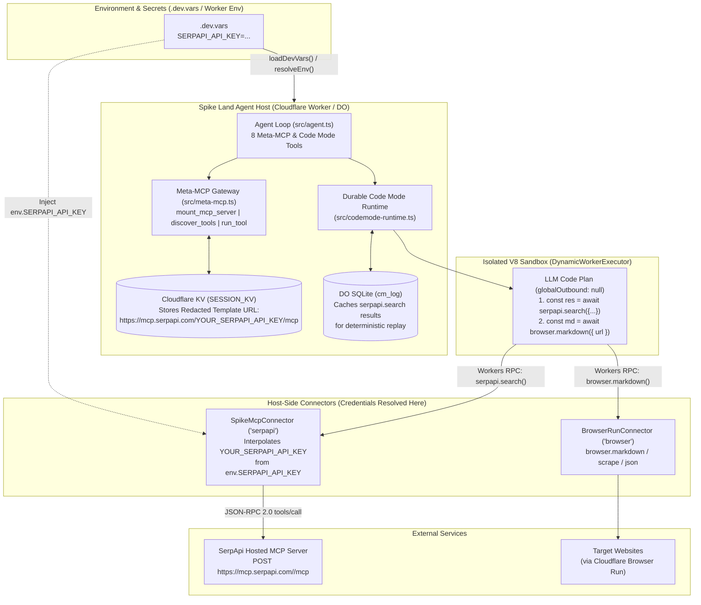

# Product Requirements Document (PRD): SerpApi MCP Server Integration (`serpapi`)

**Document Version:** 1.0  
**Target File:** `./prds/serpapi.md`  
**Upstream MCP Endpoint:** `https://mcp.serpapi.com/YOUR_SERPAPI_API_KEY/mcp` (and `https://mcp.serpapi.com/mcp`)  
**Upstream Reference:** [SerpApi Official MCP Server (`serpapi/serpapi-mcp`)](https://github.com/serpapi/serpapi-mcp)  
**Date:** 2026-10-22  
**Author:** Spike Land Engineering  
**Status:** Proposed / Ready for Implementation  
**Target Runtime:** Cloudflare Workers (`spike-vinext` / Meta-MCP Gateway + Durable Code Mode Runtime + `.dev.vars` Secret Injection)

---

## 1. Executive Summary & Core Thesis

While Spike Land's native `browser.*` tools (`BrowserRunConnector`: `browser.markdown`, `browser.scrape`, `browser.json`, `browser.links`) excel at extracting content when an agent **already knows the target URL**, agents frequently need **real-time multi-engine search discovery** first—finding live URLs, news articles, academic papers, product pricing, local businesses, or knowledge graph answers across Google, Bing, DuckDuckGo, YouTube, Google Scholar, Amazon, and eBay.

By integrating the official **SerpApi Hosted MCP Server** (`mcp.serpapi.com`) into the Spike Land Meta-MCP Gateway (`src/meta-mcp.ts`) and Durable Code Mode Runtime (`src/codemode-runtime.ts`), agents gain instant access to `serpapi.search` backed by the `SERPAPI_API_KEY` configured in `.dev.vars` (local development) and Cloudflare Worker Secrets (production).

### Canonical MCP Configuration Target
```json
{
  "mcpServers": {
    "serpapi": {
      "type": "http",
      "url": "https://mcp.serpapi.com/YOUR_SERPAPI_API_KEY/mcp"
    }
  }
}
```

### Why SerpApi + Durable Code Mode (`codemode`) Is a Force Multiplier
1. **Zero-Leakage Path & Header Authentication:** The user's `SERPAPI_API_KEY` (already present in `.dev.vars`) is injected strictly at the host Worker `fetch()` boundary—supporting both SerpApi's path-embedded URL pattern (`https://mcp.serpapi.com/YOUR_SERPAPI_API_KEY/mcp`) and Bearer header authentication—so the raw API key **never** enters the LLM prompt, tool arguments, V8 sandbox, or Cloudflare `SESSION_KV`.
2. **1-Turn Search-Then-Scrape Pipelines in Code Mode:** Inside a single `codemode` execution (`DynamicWorkerExecutor`), an agent can call `await serpapi.search({ params: { q: "...", engine: "google_light" }, mode: "compact" })`, filter the top organic links in JavaScript, and immediately extract full page markdown via `await browser.markdown({ url })` in one LLM turn.
3. **Deterministic Credit Conservation via SQLite Replay:** Because `SpikeMcpConnector` logs every `serpapi.search` execution in Durable Object SQLite (`cm_log` with `replay: "log"`), if a multi-step `codemode` script pauses at a downstream mutation (`requiresApproval: true`) and is later approved, prior `serpapi.search` steps replay instantly from SQLite without re-billing SerpApi search credits.

---

## 2. Problem Statement

1. **Path-Embedded API Keys vs. Strict Secret Guardrails:**
   - Standard MCP configurations for SerpApi embed the API key directly in the endpoint path: `https://mcp.serpapi.com/YOUR_SERPAPI_API_KEY/mcp`.
   - In `spike-vinext`, passing a real API key inside a URL from the LLM violates our zero-trust secret guardrail (`detectPlaintextSecret`), and storing a resolved URL in `SESSION_KV` (`sessionState.mountedServers`) would persist raw credentials in KV storage.
   - Currently, `mountMcpServer` (`src/meta-mcp.ts`) and `SpikeMcpConnector` (`src/connectors/spike-mcp-connector.ts`) only inject `authSecretName` into `Authorization: Bearer <token>` headers and do not interpolate URL placeholders (`YOUR_SERPAPI_API_KEY`, `{SERPAPI_API_KEY}`, or `${SERPAPI_API_KEY}`) at request dispatch time.
2. **Manual Mounting Friction When `SERPAPI_API_KEY` Is Already in `.dev.vars`:**
   - When `SERPAPI_API_KEY` is already provisioned in `.dev.vars` (loaded automatically by `loadDevVars()` in `src/index.ts`), the agent should not have to guess the upstream SerpApi MCP URL or waste a turn mounting it from scratch if it can be pre-configured or mounted via a canonical preset.
3. **SERP Payload Bloat in LLM Context:**
   - Raw SerpApi responses (`mode: "complete"`) include extensive metadata, pagination links, related searches, and inline HTML snippets that can exceed 25–40 KB per query. Without compact defaults (`mode: "compact"` or `params.output: "md"`) and V8 sandbox filtering (`codemode`), multi-query research quickly exhausts context windows.
4. **Streamable HTTP Framing (`text/event-stream` vs. `application/json`):**
   - Hosted MCP servers over Streamable HTTP (`type: "http"`) may respond with either `application/json` or `text/event-stream` (SSE framing) depending on `Accept` headers (`Accept: application/json, text/event-stream`) and session initialization (`Mcp-Session-Id`). The gateway and connector must seamlessly handle both response formats.

---

## 3. Goals & Non-Goals

### 3.1 Goals (In-Scope)
* **Host-Side URL Template Interpolation:** Support placeholder tokens (`YOUR_SERPAPI_API_KEY`, `{SERPAPI_API_KEY}`, `${SERPAPI_API_KEY}`, or `{AUTH_SECRET}`) in `mount_mcp_server` URLs. The uninterpolated template URL is stored in `SESSION_KV`, while the real `env.SERPAPI_API_KEY` from `.dev.vars` is substituted strictly in-memory inside the host `fetch()` call (alongside `Authorization: Bearer` header injection).
* **Automatic / Preset `serpapi` Availability:** When `env.SERPAPI_API_KEY` is present in `.dev.vars` or Worker secrets, support:
  1. **On-Demand Mounting:** Calling `mount_mcp_server({ namespace: "serpapi", url: "https://mcp.serpapi.com/YOUR_SERPAPI_API_KEY/mcp", authSecretName: "SERPAPI_API_KEY" })` (or automatically inferring `authSecretName: "SERPAPI_API_KEY"` when `YOUR_SERPAPI_API_KEY` is in the URL).
  2. **Default Session Pre-Registration (Optional/Configurable):** Pre-populating or lazy-hydrating the `serpapi` server in `getSessionState` when `env.SERPAPI_API_KEY` is defined so `discover_tools({ query: "serpapi search" })`, `run_tool("serpapi.search", ...)`, and `await serpapi.search(...)` in `codemode` work out of the box.
* **Full Durable Code Mode (`codemode`) Bridge:** Expose `serpapi.search` inside `SpikeMcpConnector` with `requiresApproval: false` and `replay: "log"`, enabling 1-turn `serpapi.search` + `browser.*` orchestration in the isolated V8 sandbox.
* **Secret Redaction on Error & Logs:** Ensure any upstream HTTP or network error message scrubs the resolved `SERPAPI_API_KEY` value before returning error text to the LLM or logs (`https://mcp.serpapi.com/[REDACTED]/mcp`).

### 3.2 Non-Goals
* **Local Python/`uv` STDIO Execution:** We connect strictly to the official hosted HTTP MCP endpoint (`https://mcp.serpapi.com/.../mcp`) rather than spawning local Python `src/stdio.py` subprocesses, maintaining 100% compatibility with Cloudflare Workers V8 isolates.
* **Direct REST Wrapper Replacing MCP:** Rather than hardcoding a bespoke REST client for `serpapi.com/search.json`, we use the standard MCP protocol (`tools/list`, `tools/call`) via `mcp.serpapi.com` so SerpApi remains a true MCP citizen in our Meta-MCP and Code Mode architecture.

---

## 4. System Architecture & Runtime Flow

### 4.1 High-Level Architecture



### 4.2 Search-to-Scrape Sequence in Durable Code Mode

```text
┌─────────┐          ┌──────────────────────────┐          ┌─────────────────────────┐          ┌────────────────────────┐
│  Agent  │          │  SpikeMcpConnector       │          │  DynamicWorkerExecutor  │          │  mcp.serpapi.com       │
│  (LLM)  │          │  (Host Worker + Env)     │          │  (Isolated V8 Sandbox)  │          │  (Hosted HTTP MCP)     │
└────┬────┘          └────────────┬─────────────┘          └────────────┬────────────┘          └───────────┬────────────┘
     │                            │                                     │                                   │
     │ 1. Call `codemode`:        │                                     │                                   │
     │    const s = await         │                                     │                                   │
     │      serpapi.search({...});│                                     │                                   │
     │    const md = await        │                                     │                                   │
     │      browser.markdown(...);│                                     │                                   │
     ├───────────────────────────►├────────────────────────────────────►│                                   │
     │                            │                                     │ 2. RPC: serpapi.search({          │
     │                            │                                     │      params: { q, engine },       │
     │                            │                                     │      mode: "compact"              │
     │                            │◄────────────────────────────────────┤    })                             │
     │                            │                                     │                                   │
     │                            │ 3. Interpolate URL on Host:         │                                   │
     │                            │    YOUR_SERPAPI_API_KEY -> env key  │                                   │
     │                            │    POST /<SERPAPI_API_KEY>/mcp      │                                   │
     │                            ├─────────────────────────────────────┼──────────────────────────────────►│
     │                            │                                     │                                   │
     │                            │ 4. Return structured SERP JSON/MD   │                                   │
     │                            │◄────────────────────────────────────┼───────────────────────────────────┤
     │                            │    [Log seq: 1 in SQLite cm_log]    │                                   │
     │                            ├────────────────────────────────────►│                                   │
     │                            │                                     │ 5. Filter top URLs in JS & call   │
     │                            │◄────────────────────────────────────┤    browser.markdown({ url })      │
     │                            │    [Execute Browser Run seq: 2]     │                                   │
     │                            ├────────────────────────────────────►│                                   │
     │ 6. Return distilled answer │◄────────────────────────────────────┤                                   │
     │◄───────────────────────────┤                                     │                                   │
```

---

## 5. Detailed Feature & Protocol Specifications

### 5.1 Upstream SerpApi MCP Server Contract

The official `mcp.serpapi.com` HTTP server implements the MCP specification (`protocolVersion: "2024-11-05"` / `"2025-03-26"`) over Streamable HTTP:

1. **Endpoint & Authentication Modes:**
   - **Path-Based Auth (Canonical):** `https://mcp.serpapi.com/YOUR_SERPAPI_API_KEY/mcp` where `YOUR_SERPAPI_API_KEY` is replaced by `env.SERPAPI_API_KEY`.
   - **Bearer Header Auth (Alternative):** `https://mcp.serpapi.com/mcp` with `Authorization: Bearer <SERPAPI_API_KEY>`.
   - **Unauthenticated Discovery:** `tools/list` succeeds even without an API key, while `tools/call` (`search`) validates the API key.

2. **Exposed Tool (`serpapi.search`):**
   - **Upstream Name:** `search`
   - **Namespaced Name in Spike Land:** `serpapi.search`
   - **Input Schema:**
     ```json
     {
       "type": "object",
       "properties": {
         "params": {
           "type": "object",
           "description": "Engine-specific query parameters passed to SerpApi (e.g. { q: 'cloudflare workers', engine: 'google_light', location: 'United States', output: 'md' }).",
           "properties": {
             "q": {
               "type": "string",
               "description": "Search query string."
             },
             "engine": {
               "type": "string",
               "description": "Search engine to query (default: 'google_light'). Examples: 'google', 'google_light', 'google_news', 'google_scholar', 'google_maps', 'google_finance', 'google_patents', 'bing', 'duckduckgo', 'youtube', 'ebay', 'amazon'."
             },
             "location": {
               "type": "string",
               "description": "Optional geographic location for localized search results (e.g. 'Austin, TX')."
             },
             "output": {
               "type": "string",
               "enum": ["json", "md"],
               "description": "Response format: omit or 'json' for structured JSON, or 'md' for token-efficient Markdown."
             }
           },
           "required": ["q"],
           "additionalProperties": true
         },
         "mode": {
           "type": "string",
           "enum": ["complete", "compact"],
           "default": "compact",
           "description": "Response verbosity mode when returning JSON: 'compact' strips noisy metadata to save context tokens; 'complete' returns full raw metadata."
         }
       },
       "required": ["params"]
     }
     ```
   - **Generated TypeScript Signature for `codemode` (`discover_tools({ query: "serpapi", format: "typescript" })`):**
     ```typescript
     serpapi.search(args: {
       params: {
         q: string;
         engine?: string;
         location?: string;
         output?: string;
         [key: string]: unknown;
       };
       mode?: "complete" | "compact";
     }): Promise<any>;
     ```

3. **Exposed MCP Resources (Reference):**
   - `serpapi://engines`: Lists all supported search engine identifiers on SerpApi.
   - `serpapi://engines/<engine>`: Returns the full parameter specification for a specific search engine (e.g., `serpapi://engines/google_scholar`).

---

### 5.2 Host-Side URL Template & Secret Resolution

To support the exact configuration snippet provided by the user:
```json
{
  "mcpServers": {
    "serpapi": {
      "type": "http",
      "url": "https://mcp.serpapi.com/YOUR_SERPAPI_API_KEY/mcp"
    }
  }
}
```
we introduce **Host-Side URL Secret Interpolation** in `src/meta-mcp.ts` and `src/connectors/spike-mcp-connector.ts`:

1. **Supported URL Secret Placeholders:**
   - `YOUR_SERPAPI_API_KEY` $\rightarrow$ automatically maps to `env.SERPAPI_API_KEY` (or `server.authSecretName` if specified).
   - `YOUR_<NAME>_API_KEY` / `{<SECRET_NAME>}` / `${<SECRET_NAME>}` $\rightarrow$ maps to `env[<SECRET_NAME>]` or `env[server.authSecretName]`.
2. **Automatic `authSecretName` Inference on Mount:**
   - When `mountMcpServer` receives `url: "https://mcp.serpapi.com/YOUR_SERPAPI_API_KEY/mcp"` (or `namespace: "serpapi"`) and `authSecretName` is omitted, it automatically infers `authSecretName = "SERPAPI_API_KEY"`.
   - When `mountMcpServer` receives `url: "https://mcp.serpapi.com/mcp"` with `namespace: "serpapi"`, it also defaults `authSecretName = "SERPAPI_API_KEY"` if `env.SERPAPI_API_KEY` exists.
3. **Zero-Persistence of Raw Key in `SESSION_KV`:**
   - If a caller or local config passes a URL that happens to contain the literal `env.SERPAPI_API_KEY` value, `sanitizeServerUrlForStorage(url, env)` replaces the literal key with `YOUR_SERPAPI_API_KEY` before saving `MountedServer` into `SESSION_KV`.
   - At runtime (`mountMcpServer`, `runTool`, and `SpikeMcpConnector.execute`), `resolveUpstreamServerUrl(server.url, server.authSecretName, env)` substitutes `YOUR_SERPAPI_API_KEY` (or `{SERPAPI_API_KEY}`) with `env.SERPAPI_API_KEY` strictly in memory for the `fetchImpl()` call.
4. **Secret Redaction in Error Messages:**
   - Any error thrown or returned by `fetchImpl()` passes through `redactSecretFromText(message, resolvedSecret)` so a network error to `https://mcp.serpapi.com/<secret>/mcp` never echoes the raw API key back to the chat transcript.

---

### 5.3 Streamable HTTP Content-Type & SSE Response Parsing

Hosted MCP servers at `type: "http"` endpoints (`https://mcp.serpapi.com/.../mcp`) follow the MCP Streamable HTTP transport:
- **Request Headers:**
  ```http
  POST /<SERPAPI_API_KEY>/mcp HTTP/1.1
  Host: mcp.serpapi.com
  Content-Type: application/json
  Accept: application/json, text/event-stream
  ```
- **Response Parsing (`parseMcpHttpResponse`):**
  - If the upstream response `Content-Type` is `application/json`, parse the JSON body directly.
  - If the upstream response `Content-Type` is `text/event-stream` (SSE), extract `data: {...}` lines from the SSE stream and parse the JSON-RPC message matching the request `id` (or the final JSON-RPC result payload).
  - If the upstream server returns an `Mcp-Session-Id` header during `initialize`, forward it on the subsequent request when performing the `initialize` $\rightarrow$ `tools/list` or `initialize` $\rightarrow$ `tools/call` retry sequence.

---

### 5.4 Built-In `serpapi` Preset & Auto-Availability

When `SERPAPI_API_KEY` is present in `.dev.vars` (loaded into `env.SERPAPI_API_KEY` via `resolveEnv()` in `src/index.ts`):

1. **Built-In Preset Definition (`SERPAPI_DEFAULT_SERVER`):**
   - Even before an explicit `mount_mcp_server` call, if `env.SERPAPI_API_KEY` is configured and `sessionState.mountedServers["serpapi"]` is not yet populated, the session automatically registers a pre-configured `serpapi` server entry with the canonical `serpapi.search` schema and template URL `https://mcp.serpapi.com/YOUR_SERPAPI_API_KEY/mcp`.
   - This means:
     - `discover_tools({ query: "serpapi" })` or `discover_tools({ query: "search google web" })` immediately surfaces `serpapi.search`.
     - `run_tool({ tool_name: "serpapi.search", arguments: { params: { q: "..." }, mode: "compact" } })` works on Turn 1 without wasting a turn calling `mount_mcp_server`.
     - Inside `codemode`, `await serpapi.search({ params: { q: "..." }, mode: "compact" })` is immediately bound as a global connector namespace (`serpapi`) alongside `browser`.
2. **Explicit `mount_mcp_server` Compatibility:**
   - Agents or tests can still explicitly call `mount_mcp_server({ namespace: "serpapi", url: "https://mcp.serpapi.com/YOUR_SERPAPI_API_KEY/mcp" })` at any time to refresh the live upstream `tools/list` schema from `mcp.serpapi.com`.

---

## 6. Data Models & Code Changes

### 6.1 `src/types.ts` Updates
Add `SERPAPI_API_KEY?: string;` to the `Env` interface:

```typescript
export interface Env {
  SESSION_KV: KVNamespace;
  OPENROUTER_API_KEY?: string;
  LLM_API_KEY?: string;
  GEMINI_API_KEY?: string;
  SERPAPI_API_KEY?: string;
  LLM_BASE_URL?: string;
  LLM_MODEL?: string;
  // Dynamic upstream secrets stored as Worker secrets (e.g. env["GITHUB_TOKEN"])
  [key: string]: unknown;
}
```

### 6.2 URL Secret Resolution Helper (`src/security.ts` / `src/meta-mcp.ts`)

```typescript
/**
 * Resolves URL placeholders such as `YOUR_SERPAPI_API_KEY`, `{SERPAPI_API_KEY}`,
 * or `${SERPAPI_API_KEY}` using Worker environment secrets at request time.
 */
export function resolveServerUrlAndAuth(
  rawUrl: string,
  authSecretName: string | undefined,
  env: Env
): {
  resolvedUrl: string;
  templateUrl: string;
  secretKeyName?: string;
  bearerToken?: string;
  secretValue?: string;
  error?: string;
} {
  let inferredSecretName = authSecretName?.startsWith("env:")
    ? authSecretName.slice(4)
    : authSecretName;

  // Detect YOUR_<NAME>_API_KEY or {SECRET_NAME} in URL
  const placeholderMatch =
    rawUrl.match(/YOUR_([A-Z0-9_]+)_KEY/) ||
    rawUrl.match(/\$\{([A-Z0-9_]+)\}/) ||
    rawUrl.match(/\{([A-Z0-9_]+)\}/);

  if (!inferredSecretName && placeholderMatch) {
    const captured = placeholderMatch[1];
    inferredSecretName = rawUrl.includes(`YOUR_${captured}_KEY`)
      ? `${captured}_KEY`
      : captured;
  }

  if (!inferredSecretName && rawUrl.includes("mcp.serpapi.com") && env.SERPAPI_API_KEY) {
    inferredSecretName = "SERPAPI_API_KEY";
  }

  let secretValue: string | undefined;
  if (inferredSecretName) {
    const val = env[inferredSecretName];
    if (typeof val === "string" && val.trim().length > 0) {
      secretValue = val.trim();
    } else if (authSecretName || placeholderMatch) {
      return {
        resolvedUrl: rawUrl,
        templateUrl: rawUrl,
        secretKeyName: inferredSecretName,
        error: `Worker secret '${inferredSecretName}' not found in environment.`,
      };
    }
  }

  let resolvedUrl = rawUrl;
  let templateUrl = rawUrl;

  if (secretValue && inferredSecretName) {
    // If the user passed the literal secret in the URL from local config, scrub it for storage
    if (rawUrl.includes(secretValue)) {
      templateUrl = rawUrl.replaceAll(secretValue, `YOUR_${inferredSecretName}`);
    }
    // Replace placeholder tokens with the actual secret value for upstream fetch
    resolvedUrl = templateUrl
      .replaceAll(`YOUR_${inferredSecretName}`, encodeURIComponent(secretValue))
      .replaceAll(`\${${inferredSecretName}}`, encodeURIComponent(secretValue))
      .replaceAll(`{${inferredSecretName}}`, encodeURIComponent(secretValue));
  }

  // Only attach Authorization Bearer header if the secret wasn't already embedded in the URL path,
  // or attach it safely if supported
  const isEmbeddedInUrl = secretValue ? resolvedUrl.includes(encodeURIComponent(secretValue)) : false;

  return {
    resolvedUrl,
    templateUrl,
    secretKeyName: inferredSecretName,
    bearerToken: !isEmbeddedInUrl ? secretValue : undefined,
    secretValue,
  };
}
```

### 6.3 Example `codemode` Orchestration with `serpapi` + `browser`

With `serpapi` and `browser` both registered as connectors in `createSpikeCodemodeRuntime`:

```javascript
async () => {
  // Step 1: Query SerpApi for real-time search results in compact mode
  const searchResult = await serpapi.search({
    params: {
      q: "Cloudflare Durable Code Mode runtime agents sdk",
      engine: "google_light",
    },
    mode: "compact",
  });

  // Step 2: Extract top 2 organic links inside the V8 sandbox
  const rawText = typeof searchResult === "string" ? searchResult : JSON.stringify(searchResult);
  const parsed = typeof searchResult === "object" && searchResult !== null ? searchResult : {};
  const organic = parsed.organic_results || [];
  const topUrls = organic.slice(0, 2).map((item) => item.link).filter(Boolean);

  // Step 3: Scrape markdown from top results using BrowserRunConnector
  const pages = [];
  for (const url of topUrls) {
    const md = await browser.markdown({ url });
    pages.push({
      url,
      preview: String(md).slice(0, 600),
    });
  }

  return {
    query: "Cloudflare Durable Code Mode runtime agents sdk",
    totalOrganicFound: organic.length,
    extractedPages: pages,
  };
}
```

---

## 7. Security, Privacy & Cost Guardrails

1. **Zero Secret Leakage (`SERPAPI_API_KEY` Isolation):**
   - `SERPAPI_API_KEY` is read on the host Worker via `loadDevVars()` / `env.SERPAPI_API_KEY`.
   - `SESSION_KV` only ever stores `"https://mcp.serpapi.com/YOUR_SERPAPI_API_KEY/mcp"` and `authSecretName: "SERPAPI_API_KEY"`.
   - The `DynamicWorkerExecutor` V8 sandbox runs with `globalOutbound: null` and zero access to `env`.
   - Error messages scrub `secretValue` via `redactSecret(text, secretValue)` before returning to the caller.
2. **Read-Only Classification (`requiresApproval: false`):**
   - `isMutatingMcpTool("search")` in `src/connectors/spike-mcp-connector.ts` evaluates to `false` because `"search"` is in `readOnlyPrefixes` / read-only classification.
   - Therefore, `serpapi.search` executes immediately in `codemode` without pausing for human approval.
3. **Replay Caching in SQLite (`replay: "log"`):**
   - Every `serpapi.search` call inside `codemode` is recorded in `cm_log` in Durable Object SQLite. If a later step in the same script triggers an approval pause (e.g., `gh.create_issue`), approving the execution replays the cached `serpapi.search` response from SQLite rather than consuming an extra SerpApi credit.
4. **32 KB Output Cap:**
   - Both `runTool` and `SpikeMcpConnector` enforce `MAX_PAYLOAD_CHARS = 32768` so even a `mode: "complete"` search cannot overflow the Worker memory or LLM prompt budget.

---

## 8. Phased Implementation Plan

### Phase 1: Host-Side URL Secret Interpolation & SSE/JSON Transport Support
- [ ] Update `src/types.ts` to include `SERPAPI_API_KEY?: string` on `Env`.
- [ ] Implement `resolveServerUrlAndAuth` and `redactSecret` in `src/security.ts` / `src/meta-mcp.ts` to support `https://mcp.serpapi.com/YOUR_SERPAPI_API_KEY/mcp` (and `{SERPAPI_API_KEY}`).
- [ ] Add Streamable HTTP SSE/JSON response parsing (`Accept: application/json, text/event-stream`) in `mountMcpServer`, `runTool`, and `SpikeMcpConnector` so `mcp.serpapi.com` responses parse cleanly whether returned as JSON or SSE `data:` frames.

### Phase 2: Pre-Configured `serpapi` Namespace & Code Mode Connector
- [ ] Add `SERPAPI_DEFAULT_SERVER` in `src/meta-mcp.ts` so whenever `env.SERPAPI_API_KEY` is defined (e.g. in `.dev.vars`), sessions automatically include the `serpapi` namespace (`serpapi.search`) without requiring a manual mount step, while still allowing `mount_mcp_server` to live-refresh tools from `https://mcp.serpapi.com/YOUR_SERPAPI_API_KEY/mcp`.
- [ ] Update `SYSTEM_PROMPT` in `src/agent.ts` to inform the agent that `serpapi.search` is available for multi-engine web/news/scholar search alongside `browser.*` for URL content extraction.

### Phase 3: Unit & Live E2E Verification with `.dev.vars`
- [ ] Add unit and live integration tests in `test/serpapi-mcp.test.ts` verifying:
  1. Mounting `https://mcp.serpapi.com/YOUR_SERPAPI_API_KEY/mcp` with `SERPAPI_API_KEY` from `.dev.vars`.
  2. Verifying `SESSION_KV` stores only the redacted placeholder URL `https://mcp.serpapi.com/YOUR_SERPAPI_API_KEY/mcp`.
  3. Discovering `serpapi.search` in both `"json_schema"` and `"typescript"` formats.
  4. Executing a live `run_tool("serpapi.search", ...)` query against `mcp.serpapi.com`.
  5. Executing a live `codemode` script combining `await serpapi.search(...)` and data filtering in the isolated V8 sandbox.

---

## 9. Acceptance Criteria

* **AC1 (Canonical Config URL Support):** Passing `"url": "https://mcp.serpapi.com/YOUR_SERPAPI_API_KEY/mcp"` and `"namespace": "serpapi"` to `mount_mcp_server` resolves `env.SERPAPI_API_KEY` from `.dev.vars` on the host, completes the `tools/list` handshake with `mcp.serpapi.com`, and stores only the uninterpolated `YOUR_SERPAPI_API_KEY` template URL in `SESSION_KV`.
* **AC2 (Zero-Turn Availability When `SERPAPI_API_KEY` Is Present):** When `SERPAPI_API_KEY` is present in `.dev.vars`, `discover_tools({ query: "serpapi search" })` returns `serpapi.search` (and its TypeScript signature when `format: "typescript"`), and `run_tool({ tool_name: "serpapi.search", arguments: { params: { q: "Cloudflare Workers", engine: "google_light" }, mode: "compact" } })` returns live search results.
* **AC3 (Durable Code Mode Sandbox Integration):** Inside a `codemode` execution (`DynamicWorkerExecutor` with `globalOutbound: null`), an agent can invoke `await serpapi.search({ params: { q: "..." }, mode: "compact" })`, process the structured results in JavaScript, and chain them with `browser.*` tools or downstream connectors.
* **AC4 (Strict Secret Redaction):** `env.SERPAPI_API_KEY` is never exposed in `SESSION_KV`, `discover_tools` output, `cm_log` connector metadata, or upstream HTTP error messages.
